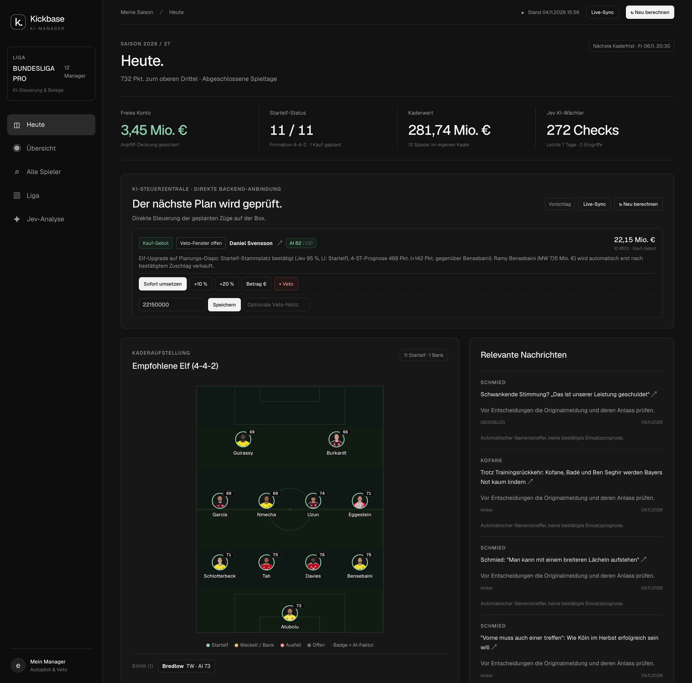
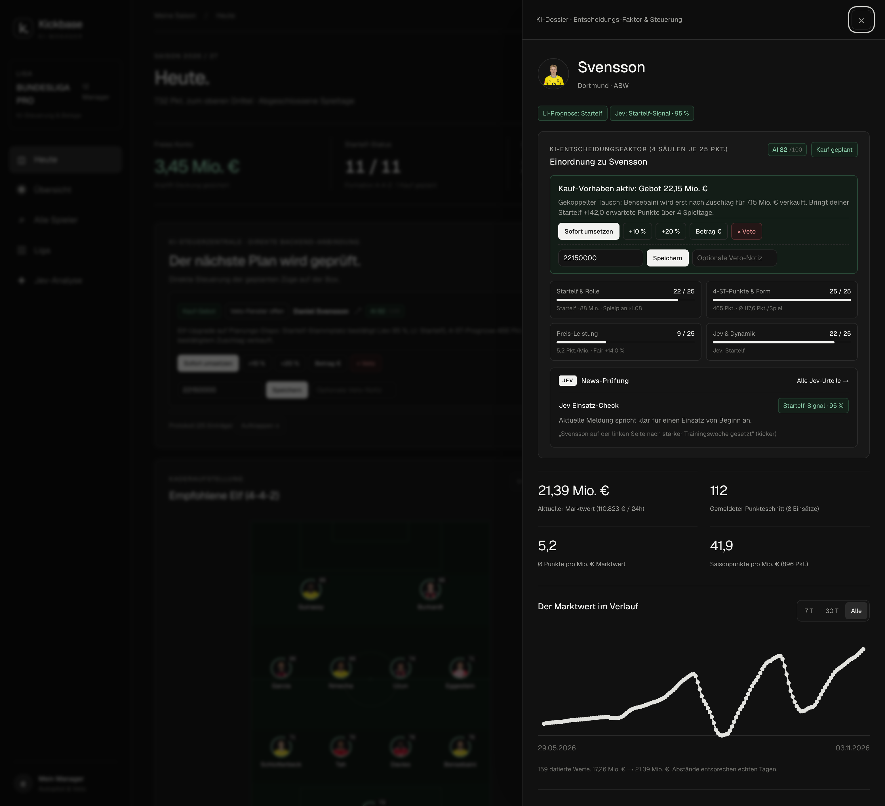
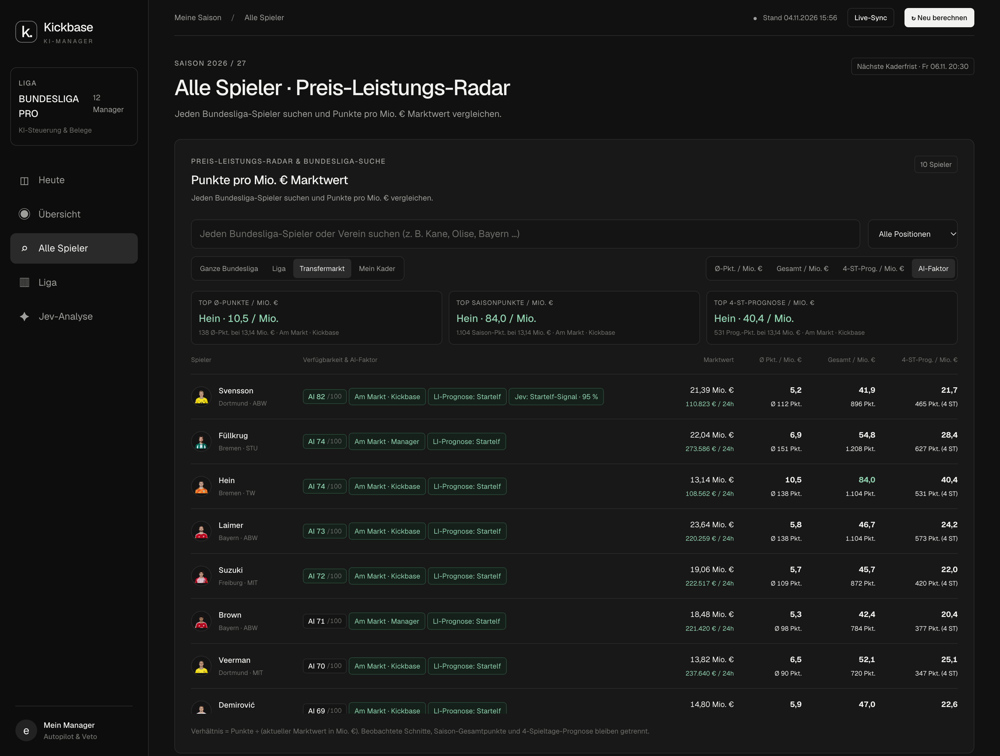

# Kickbase KI-Copilot & Autonomes Web-Cockpit

[](https://github.com/milopraetzel/kickbase-copilot/actions)

Ein selbstgehosteter **KI-Co-Pilot und autonomer Handels-Agent für Kickbase** (Python 3.12 · FastAPI · SQLite · Docker).

Der Agent verbindet sich lokal mit deinem eigenen Kickbase-Account, liest im 10-Minuten-Takt deinen Kader, den Transfermarkt, 160-Tage-Marktwert-Kurven, Verletzungs-/Aufstellungs-Meldungen sowie alle Mitspieler-Kader deiner Liga aus – und berechnet daraus eine **4-Säulen-Strategie (AI-Faktor 0–100)** inklusive kompletter Tausch-Ketten auf Dispo.

> **100 % Self-Hosted & volle Kontrolle:** Deine Kickbase-Zugangsdaten verlassen niemals deinen eigenen Rechner oder Server. Über das **integrierte Regelwerk (6. Haupt-Tab `⚙ Regelwerk` in der Web-App + 5-Schritte-Onboarding im KI-Chat)** bestimmst du exakt, ob der Agent nur als **stiller Berater (`dry_run`)**, als **Co-Pilot mit Veto-Countdown (`veto_copilot`)** oder als **Voll-Autopilot (`full_autopilot`)** arbeitet.

---

## Einblicke ins Web-Cockpit

### 1. KI-Steuerzentrale (Veto-Fenster), Empfohlene Startelf & Transfermarkt-Radar


### 2. Spieler-KI-Dossier (4-Säulen-Aufschlüsselung, 160-Tage-Marktwert-Kurve & Liga-Wettbewerb)


### 3. Bundesliga Preis-Leistungs-Radar (Alle ~400 Spieler nach 4-Spieltage-Prognose pro Mio. €)


---

## Wie die KI dahinter tickt

1. **News- & Rollen-Analyse („Jev“ + LigaInsider/kicker-Scout):**
   Scant laufend voraussichtliche Aufstellungen, Verletztenlisten und News-Meldungen (Fail-Closed gesichert). Falls ein optionaler `TYPESAFE_API_KEY` (Jev) hinterlegt ist, werden Textmeldungen probabilistisch in Startelf-Wahrscheinlichkeiten übersetzt; ohne Key greift automatisch das integrierte Heuristik- & LigaInsider-Modell.
2. **4-Säulen AI-Faktor (0–100) & 4-Spieltage-Horizont:**
   - **Rolle & Minuten:** Stetige Startelf- & Joker-Wahrscheinlichkeit statt starrer 0/1-Stufen
   - **Form & Matchup:** Erwartete Punkte über die kommenden **4 Spieltage**, gewichtet mit den Gegner-Quoten (`×1.09` bei leichtem Programm, `×0.92` gegen Top-Gegner)
   - **Preis-Leistung:** Punkte und 4-Spieltage-Prognose pro Mio. € im Vergleich zur gesamten Bundesliga-Wolke
   - **Marktwert-Momentum & Mitspieler-Knappheit:** Erkennt Unter-der-Woche-Steiger für Dispo-Trading und berücksichtigt bei Auktionen, wie viele Mitspieler auf einer Position akuten Bedarf haben
3. **Verzögerte Tausch-Ketten auf Dispo (`swap`):**
   Der Agent verkauft niemals blind zuerst deinen Stammspieler. Er bietet auf das berechnete Upgrade und hinterlegt den Verkauf des abgelösten Kaderspielers als **bedingtes Folge-Vorhaben** – erst wenn der Zuschlag wirklich da ist, wird der alte Spieler verkauft.

---

## Einstellungsmenü & Synchrones 5-Schritte-KI-Onboarding

Sowohl der **6. Haupt-Tab `⚙ Regelwerk` in der Web-App** als auch der **KI-Chat (Claude Code, Cursor, Antigravity, Codex)** lesen und schreiben dieselbe `data/agent_rules.json` (Details in [`ONBOARDING.md`](./ONBOARDING.md)):

* **3 Schnell-Profile per 1-Klick:**
  1. **Nur Berater (`dry_run`):** Rechnet alles durch, klickt aber nie in Kickbase.
  2. **Co-Pilot mit Veto-Countdown (`veto_copilot`):** Plant Transfers mit Countdown im Cockpit; du hast jederzeit das letzte Wort (`+10 %`, `Betrag €`, `× Veto`).
  3. **Voll-Autopilot (`full_autopilot`):** Führt Stammelf-Upgrades, Unter-der-Woche-Trading, Startelf-Aufstellung und Freitags-Dispo-Ausgleich selbstständig aus.
* **Fein-Steuerung & Klick-Schutzliste:**
  - Maximales Einzelgebot (`max_bid_million`) & maximaler Overpay (`max_overpay_pct`)
  - Verkaufs-Erlaubnis (`none` | `bench_only` | `swap_allowed`)
  - Unter-der-Woche Trading-Dispo-Deckel (`trade_budget_cap_million`) & Freitags-Sicherheits-Haircut (`friday_buffer_haircut_pct`)
  - **Anklickbare Kader-Schutzliste (`protected_players`):** Sperre deine Lieblingsspieler per Klick im Tab `⚙ Regelwerk` (oder im KI-Chat) gegen jeden Verkauf.

---

## Schnellstart in 2 Minuten (Live / Self-Hosted auf Port `8080`)

```bash
git clone https://github.com/milopraetzel/kickbase-copilot.git
cd kickbase-copilot
cp api/.env.example api/.env
# Kickbase-Login in api/.env eintragen, dann starten:
make dev
```

Öffne **[http://localhost:8080](http://localhost:8080)** (oder starte das geführte Onboarding im Terminal/KI-Chat mit `make onboarding`).

---

## Isolierte Staging-Umgebung für Entwickler & Mitwirkende (Port `8081`)

Du möchtest am Code mitarbeiten oder das Cockpit testen, **ohne** eigene Kickbase-Zugangsdaten einzutragen? Unsere isolierte Staging-Umgebung startet mit einem realistischen Bundesliga-Datensatz (`kba staging-seed`) und erzwungenem `AGENT_DRY_RUN=true`:

```bash
make staging
```

Öffne danach **[http://localhost:8081](http://localhost:8081)**. Alle Details zum Branch-Modell (`feature/* → staging → main`), Linter und Guardrail-Checks findest du in [`CONTRIBUTING.md`](./CONTRIBUTING.md).

---

## Lizenz

Veröffentlicht unter der [MIT-Lizenz](LICENSE). Nutzung auf eigene Gefahr; dieses Projekt steht in keiner offiziellen Verbindung zur Kickbase GmbH.
