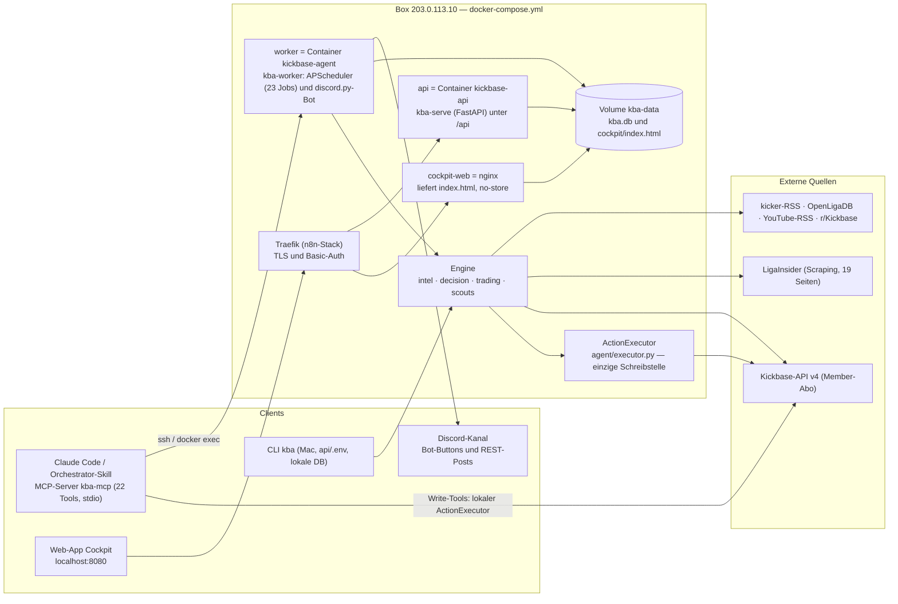
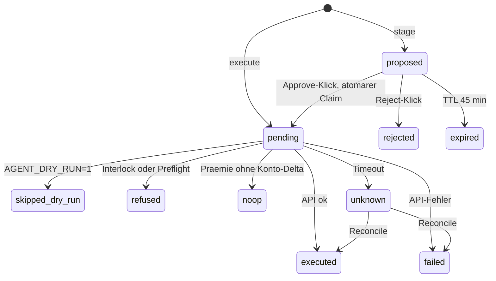
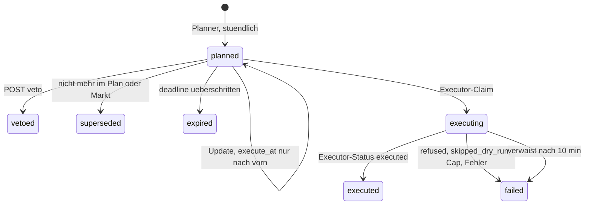

# Architektur — Kickbase-Agent (Liga BASE)

Stand: 28.10.2026 · Branch `main` · **3.374 Tests grün** · Quelle der Wahrheit ist der Code
unter `api/src/kickbase_agent/`; jede Aussage hier nennt Datei (und Funktion). Zahlen sind aus dem
Code gelesen, nicht geschätzt.

> **Neu im Projekt?** Lies zuerst **[`docs/SYSTEM-HANDBUCH.md`](SYSTEM-HANDBUCH.md)** — dort wird das gesamte Programm von Grund auf erklärt (Spielmechanik, 3-Phasen-Wochen-Trajektorie für `11/11` Starter + `Konto >= 0 €` am Freitag, und wie alle 7 Schichten ineinandergreifen). Dieses Dokument (`ARCHITEKTUR.md`) ist die detaillierte Paket- und Schnittstellen-Referenz.

## 1. Was das System ist

Der Kickbase-Agent ist ein autonomer Manager für Emils Fantasy-Bundesliga-Team in der Liga
„BASE" (12 Manager). Ziel ist, am Freitag zum Spieltags-Anpfiff **100 % des Kapitals in 11 fitten,
verifizierten Stammspielern auf dem Platz (`Konto >= 10.000 €`)** arbeiten zu lassen und unter der
Woche den `-33 %`-Dispo-Rahmen für **gekoppelte Startelf-Tausche (`swap_bid` + `swap_sell`)** sowie
**profitable Kurzfrist-Flips (`trade_radar` + `trade_autopilot`)** zu nutzen. Die Engine
(`decision/team_optimizer.py` MILP-Solver + `cli/plan.py`) und der Handels-Autopilot
(`worker/trade_autopilot.py`) beschließen **Vorhaben** (`Intent`), zeigen sie mit Countdown in der
Web-App (`https://localhost:8080`), und führen sie nach einem **Veto-Fenster** autonom über
die einzige Schreibstelle (`agent/executor.py: ActionExecutor`) aus — Emil kann jederzeit eingreifen
(`Überspringen`, `+10 %`, `+20 %`, `Jetzt ausführen`), muss aber nicht. Leitplanken sind hart im
Code versiegelt: Kaufbelege (`decision/purchase_review.py`), Dispo- und Defizit-Heilung
(`decision/overdraft.py`, `decision/funding_recovery.py`), der `ActionExecutor` mit Kill-Switch,
Interlock, Idempotenz und Live-Preflight (`agent/executor.py`), der Ergebnis-Wächter
(`worker/outcome_guard.py`), die Anpfiff-Kaskade (`worker/kickoff_guard.py`) sowie die
200-Transfers-Ampel (`trading/trade_budget.py`). Die Jev-KI (`intel/role_judge.py`,
`intel/return_judge.py`) prüft strukturierte Ausfall-/Rückkehr-Signale aus kicker-News, führt aber
niemals selbst Writes aus.

## 2. Systemlandkarte

- **Claude Code / MCP** — der Orchestrator-Skill `.claude/skills/kickbase/SKILL.md` arbeitet über den
  MCP-Server `kba-mcp` (`mcp/server.py`, `.mcp.json`: `uv run --directory api kba-mcp`). Er läuft **lokal
  auf dem Mac** mit `api/.env` und lokaler DB; Box-Operationen per ssh (`mcp/_util.py: run_ssh`).
- **Web-App (Cockpit)** — serverseitig gerenderte Einzeldatei (`cli/cockpit/*`, `cli/dashboard.py`),
  stündlich vom Worker gebaut (`worker/cockpit_job.py`), von nginx ausgeliefert; JS lädt `/api/intents`
  und `/api/protocol` nach (`cli/cockpit/theme.py: ZENTRALE_JS`).
- **Discord** — discord.py-Bot im Worker (Approval-Buttons, `notify/discord_channel.py`) plus REST-Posts
  aus CLI/MCP; alles Gepostete wird als Bericht gespeichert (`notify/report_store.py`).
- **Worker** — `worker/__main__.py` startet Bot und `AsyncIOScheduler(timezone="Europe/Berlin")`; jeder
  Cron wird über den Wrapper `CronTrigger()` fest auf Berlin gebunden (nackte Trigger liefen 2 h zu
  spät); Jobs sind echte Coroutine-Funktionen (`make_scheduled_job`).
- **Engine + Executor** — `intel/` (Signale, Scores, Boost, Treffer-Bilanz), `decision/` (Guardrails,
  Policies, Aufstellung), `trading/` (Momentum, 33-%-Regel, Trade-Budget), `scouts/ligainsider/`
  (Startelf/Verletzungen), gebündelt in `cli/plan.py: build_plan`; jeder Kickbase-Write läuft durch
  `agent/executor.py: ActionExecutor` und hinterlässt eine Zeile in `transfer_actions`.
- **API + Daten** — `server/app.py` (FastAPI, Prozess `kba-serve`, gleiches Image/Volume) schreibt nur
  `intents`-Zeilen. SQLite im Volume (`DATABASE_URL=sqlite:////app/data/kba.db`), lokal
  `sqlite:///kba_local.db`; Schema per Alembic beim Worker-Start (`api/docker-entrypoint.sh`). Externe
  Quellen: Kickbase-API v4 (`kickbase/endpoints.py`), LigaInsider (`scouts/ligainsider/scraper.py`),
  News (`news/*`).

Technik: Python ≥ 3.12 (`api/pyproject.toml`; Docker-Image `python:3.12-slim`),
uv, FastAPI, SQLAlchemy 2 + Alembic, APScheduler 3, `scipy` (HiGHS MILP-Solver), discord.py, httpx,
`mcp`-SDK (FastMCP), Typer. Scripts: `kba`, `kba-serve`, `kba-worker`, `kba-mcp` (`[project.scripts]`).
Tests: **3.374** (pytest, unter `api/tests/`, Stand 28.10.2026).

## 3. Module

| Paket (`api/src/kickbase_agent/`) | Verantwortung | Wichtigste Dateien / Funktionen | Wer ruft es auf |
|---|---|---|---|
| `config.py` | Settings aus `.env` (pydantic-settings): Auth, Flags `agent_*`, LigaInsider, Discord | `Settings`, `get_settings()` | alle |
| `kickbase/` | Kickbase-API v4: Auth, Client mit Rate-Limit/Retry, Modelle, URL-Builder | `client.py: KickbaseClient`, `auth.py: authenticate/refresh_tokens`, `factory.py: make_kickbase_client`, `endpoints.py`, `models.py` | Worker, CLI, MCP, Server |
| `agent/` | **Einzige Schreibstelle** + Selbst-Einfrieren | `executor.py: ActionExecutor.execute/stage/execute_staged/reject_staged`, `default_preflight`, `freeze.py` | Worker-Jobs, MCP-Write-Tools, Discord-Callbacks |
| `decision/` | MILP-Mannschaftsoptimierer, Kaufbelege, Dispo-Brücke, Finanzierungs-Heilung, Guardrails, Aufstellung | `team_optimizer.py: optimize_team`, `purchase_review.py: purchase_review_veto/team_funding_veto`, `overdraft.py: planning_overdraft/midweek_swap_bridge`, `funding_recovery.py`, `guardrails.py`, `kickoff_freeze.py`, `lineup.py: best_lineup` | `cli/plan.py`, `executor.py`, Worker, MCP |
| `intel/` | Punkt-/Minuten-Prognose (`forecasting/`), Jev-KI-Prüfung (`role_judge`, `return_judge`), Signale, Treffer-Bilanz | `forecasting/`, `role_judge.py: judge_roles`, `return_judge.py: judge_returns`, `signals.py: fixture_horizon_multiplier`, `collector.py`, `community.py`, `history.py`, `evaluation.py` | `cli/plan.py`, `trade_radar.py`, `news_radar.py`, `lineup_service` |
| `scouts/ligainsider/` | Startelf-Prognose + Ausfälle, Matching, Multiplikator, Quarantäne, Profiteure | `scraper.py: fetch_snapshot`, `availability.py: resolve_availability/apply_to_candidates`, `severity.py`, `profiteur.py`, `teams.py` (18 Clubs) | `service.py: enrich_candidates` ← Plan, Lineup, Kickoff-Guard, News |
| `trading/` | Handelsbuch (`TradeBook`), 33-%-Regel, Auktions-Zuschlagsmodell (`expectation`), 200er-Ampel | `trade_book.py: load_trade_book/regular_fill/sale_deadline/sale_cover`, `expectation.py: estimate_bid_success`, `finance.py: overdraft_floor`, `trade_budget.py` | `cli/plan.py`, `trade_radar.py`, `trade_autopilot.py`, `executor.py`, `kickoff_guard.py` |
| `worker/` | Alle 24 geplanten Jobs (siehe `CLAUDE.md` §3 & §7) | `__main__.py`, `engine_cycle.py`, `intents.py`, `trade_radar.py`, `trade_autopilot.py`, `outcome_guard.py`, `kickoff_guard.py`, `daily_summary.py`, `news_radar.py`, `steiger_radar.py`, `reconcile.py`, `bonus_job.py`, `lineup_job.py`, `cockpit_job.py` | APScheduler im Worker |
| `jobs/` | Täglicher Daten-Snapshot (22:05) + Historie-Nachladen (Di 04:10) | `snapshot.py: run_snapshot`, `history_reload.py` | Worker 22:05 / Di 04:10, `kba snapshot` |
| `db/` | ORM + Session + Alembic-Migrationen | `models.py` (11 Tabellen), `session.py: SessionLocal`, `migrations/versions/*` | alle |
| `server/` | FastAPI: Steuerzentrale-API, Berichte, Lernen, Lese-Endpunkte | `app.py: create_app`, `routes/intents.py`, `routes/reports.py`, `routes/learning.py`, `auth.py: TokenCache` | `kba-serve`, Web-App-JS |
| `mcp/` | MCP-Server mit 22 Tools in 3 Gruppen | `server.py`, `tools_read.py`, `tools_ops.py`, `tools_write.py`, `_util.py` (Gates, ssh, Sperrfenster) | Claude Code via `.mcp.json` |
| `cli/` + `cli/cockpit/` | Typer-Kommandos (`kba`), Plan-Bau, Cockpit-Renderer | `__init__.py` (15 Kommandos), `plan.py: build_plan`, `dashboard.py: build_page`, `cockpit/data.py: collect`, `cockpit/theme.py`, `pages_*.py`, `ki.py` | Emil/Orchestrator, Worker (`cockpit_job`) |
| `notify/` | Kanal-Abstraktion, Discord-Bot-Kanal, Berichte-Ablage | `base.py: ApprovalChannel`, `discord_channel.py: DiscordChannel`, `report_store.py: save_report` | Worker, CLI, MCP |
| `knowledge/` | Lern-Schicht: LEARNINGS.md als Daten, Parameter-Historie, Decision-Feed, Lern-Bilanz (Belege → Status) | `__init__.py: build_learning/decision_entries`, `learnings.py`, `migrate.py`, `evidence.py`, `evidence_rules.py`, `status.py`, `self_improvement.py`, `parameters.py`, `parameter_history.json` | `/api/learning`, MCP `evaluation`, `/api/protocol`, Job „Lern-Belege" |
| `news/` | kicker-RSS, OpenLigaDB, YouTube/Reddit, Dedupe-Store | `kicker_rss.py`, `openliga.py`, `community.py`, `store.py` | News-Update, Recherche |

## 4. Entscheidungs-Pipeline

**Datenquellen** (`cli/plan.py: build_plan`): Kickbase-Kader, -Markt, -Budget, Spielplan mit Wettquoten
(`client.get_matchdays`), Teamnamen, Liga-Regeln (`get_league_rules` → `lpc` Vereinslimit), eigene
offene Gebote (`get_own_bids`, Feld `ofs`), Activity-Feed (`get_activity_feed`); aus der DB
`player_history` (MW-Verlauf) und `player_performance` (Punkte je Spieltag, nur gespielte Einsätze der
aktuellen und letzten Saison, `intel/history.py`); LigaInsider-Snapshot; `community_tips`.

**Signale** (`intel/signals.py`) → gewichtetes Mittel (`intel/engine.py: RuleEngine.score`):

| Signal | Gewicht | Berechnung (Kurzform) |
|---|---|---|
| `base_points` | 0.40 | 25-%-Perzentil der Spieltagspunkte / 100 (Sättigung); unter 3 Einsätzen Richtung 0.5 geschrumpft |
| `form` | 0.25 | Ø der letzten 3 gespielten Spiele minus Saisonschnitt, `0.5 + Δ/120` (±60 Punkte sättigen) |
| `matchup` | 0.20 | Siegwahrscheinlichkeit aus Quoten, zentriert auf 1/3: `0.5 + (p − 1/3) · 1.2` |
| `trend` | 0.15 | MW-Steigung der letzten ≤ 7 Tageswerte, ±5 % sättigen |

**Kauf-Score** (`total_score`) = alle vier Signale; **Elf-Score** (`lineup_score`) = ohne `trend`
(MW-Momentum bringt keine Punkte), Gewichte renormiert (`intel/collector.py`). Danach:

1. **LigaInsider-Veto/Dämpfer** (`scouts/ligainsider/availability.py`): beide Scores × Faktor —
   `starter` 1.0 · `bench` 0.4 · `out` 0.0 · `unknown` 1.0 (`models.py: MULTIPLIER`). Scharf nur bei
   Namens-Match ≥ 0.90 (`CONFIDENT`), Grenzfälle 0.72–0.90 werden **nicht** genullt, sondern als
   Quarantäne gemeldet (`QUARANTINE_FLOOR`). Ausfallgrund → Schwere `long/short/unknown`
   (`severity.py`) steuert den Verkaufspfad.
2. **Community-Boost** (`intel/community.py: apply_community_boost`): nur Kaufpfad, ±`MAX_BOOST` 0.08
   × Tipp-Gewicht, Tipps verfallen nach 4 Tagen (`TIP_TTL_DAYS`), ein Tipp trifft genau einen besten
   Namens-Match. Conviction-Ziele = Community-Signal ≥ 0.85 oder positionsgleicher Job-Erbe
   (`profiteur.py`).
3. **Policies** (`decision/policies.py`): `propose_buys` (Score ≥ 0.55, Erstgebot MW × 1.02 + 13.337,
   Ziel MW × 1.08 bzw. × 1.09 bei Conviction, hart gekappt auf MW × 1.10, Gebot ≤ 60 % Budget,
   Vereinslimit aus `lpc` inkl. offener Gebote, `requires_approval` über 5 M) und `propose_sells`
   (Score ≤ 0.35, geschützte Spieler nie, Kurzzeit-/unklare Verletzung = halten, Langzeit = `sell`,
   sonst `list`; Rest-Kader ≥ 11 und eine gültige Formation). `evaluate_incoming_offer`: annehmen ab
   103 % MW bei nicht steigendem MW. Vorher sperrt die 200er-Ampel: ab 195 Transfers keine Vorschläge
   (`trading/trade_budget.py: trades_blocked`, `EMERGENCY_RESERVE` 5, Warnung ab 85 %).

**Guardrails — aktuelle Defaults** (`decision/guardrails.py: Guardrails`):

| Feld | Wert | Bedeutung |
|---|---|---|
| `max_bid_pct_of_budget` | 0.60 | Einzelgebot ≤ 60 % des (um offene Gebote bereinigten) Budgets |
| `bid_overpay_fraction` / `bid_overpay_conviction` | 0.08 / 0.09 | Ziel-Aufschlag über MW (Standard / Conviction) |
| `bid_ladder_opening` | 0.02 | Erstgebot +2 % über MW (pay-as-bid-Staffelung) |
| `bid_psych_offset` | 13 337 | krummer Aufschlag gegen glatte Rivalen-Gebote |
| `bid_overpay_need` | 0.20 | Ziel-Aufschlag bei **Kader-Bedarf** (120 % MW — dort springt die Zuschlag-Erwartung von 0.45 auf 0.60) |
| `bid_ladder_raise_hours` | 2.0 | Gebots-Wächter erinnert unter 2 h Restzeit an die Erhöhung |
| `max_bid_premium` | 1.10 | harte Kappe für **Standard**-Gebote: ≤ 110 % MW |
| `max_bid_premium_need` | 1.35 | harte Kappe für als **Kader-Bedarf** markierte Gebote (`PlannedAction.squad_need`; gesetzt bei Positions-Not im Planner oder per `place_bid(squad_need=True)`): ≤ 135 % MW. Auflösung des Widerspruchs vom 26.08. — die 110-%-Kappe sperrte genau die Gebote, die die Ljubičić-Regel („für gebrauchte Starter ≥ 120 %") und die Erwartungsformel (0.60 ab 120 %, 0.80 ab 135 %) verlangen. 33-%-Regel, `max_bid_pct_of_budget` und die Tages-Caps bleiben unberührt |
| `buy_score_threshold` / `sell_score_threshold` | 0.55 / 0.35 | Kauf- bzw. Verkaufsschwelle |
| `listing_floor` / `accept_offer_floor` | 0.95 / 1.03 | eigene Listings ≥ 95 % MW; Angebote annehmen ≥ 103 % |
| `daily_buy_cap` / `daily_sell_cap` | 5 / 5 | Tages-Caps (seit 23.08., vorher 3+3) |
| `approval_threshold` | 5 000 000 | ab hier „groß": Approval-Flag bzw. Mindest-Veto-Fenster 2 h |
| `league_trade_limit_per_half` | 200 | interne Liga-Regel, Ampel in Briefing/Recherche |
| `min_balance` | 0 | projizierter Kontostand nie darunter |
| `protected_player_ids` | Code-Default `8329` (Olise); **Ist-Zustand seit 16.09.2026: leer** | **Verfassung, keine Stellschraube.** Geschützte Spieler werden nie verkauft, gelistet oder per Angebot abgegeben. Erzwungen an der einzigen Schreibstelle (`agent/executor.py`, VOR dem Kill-Switch) und damit auch gegen die Anpfiff-Notbremse (`kickoff-*`); die Vorschlags-Pfade (`propose_sells`/`propose_accepts`, Purge-Kaskade, `POST /api/intents`) bieten sie gar nicht erst an. Gesetzt wird die Liste ausschließlich über `PROTECTED_PLAYER_IDS` (.env, Emils Hoheit) — sie steht bewusst NICHT in `knowledge/parameters.GUARDRAIL_KEYS`, damit der Agent sie sich nicht selbst per Decision-Record umschreiben kann. Leer = Altverhalten (kein Schutz). Am 16.09.2026 hat Emil die Liste auf ausdrückliche Anweisung leeren lassen, um Olise zu 100 M anzubieten (`api/.env`: `PROTECTED_PLAYER_IDS=`, Sicherung `api/.env.bak-2026-09-16-olise`). Den geladenen Zustand immer im Container prüfen (`protected_player_ids()`), nie aus der Doku ableiten. |

```mermaid
flowchart TD
  SRC["Datenquellen<br/>Kickbase: Kader · Markt · Budget · Spielplan mit Quoten · lpc · eigene Gebote · Feed<br/>DB: player_history · player_performance · community_tips<br/>LigaInsider-Snapshot"]
  SIG["Signale intel/signals.py<br/>base_points 0.40 · form 0.25 · matchup 0.20 · trend 0.15"]
  SC["RuleEngine.score<br/>Kauf-Score = alle 4 · Elf-Score = ohne trend"]
  LIV["LigaInsider-Veto<br/>starter x1.0 · bench x0.4 · out x0.0 · unknown x1.0<br/>Match ab 0.90 scharf, 0.72 bis 0.90 Quarantaene"]
  CB["Community-Boost<br/>max 0.08 x Gewicht, 4 Tage TTL, nur Kaufpfad"]
  POL["Policies<br/>propose_buys ab 0.55 · propose_sells bis 0.35"]
  GR["Guardrails<br/>Caps 5 und 5 · 60 Prozent Budget · Kappe 1.10 · 200er-Ampel · lpc"]
  PLAN["Plan: cli/plan.build_plan"]
  CONS["Verbraucher: Briefing 22:15 · Puls 09/13/18 · Schatten-Scan 22:20<br/>Auto-Trading 22:30 dormant · Intent-Planner :25 · MCP research_data"]
  INT["Vorhaben in intents<br/>Veto-Fenster, Web-App: Veto · Betrag · Jetzt"]
  EXE["Intent-Executor alle 5 min → ActionExecutor<br/>Kill-Switch · Interlock · Idempotenz · Preflight"]
  KBW["Kickbase-API Write"]
  AUD["Audit transfer_actions und intents.result<br/>Reconcile :52 · Treffer-Bilanz intel/evaluation.py"]
  SRC --> SIG --> SC --> LIV --> CB --> POL --> GR --> PLAN --> CONS --> INT --> EXE --> KBW --> AUD
```

Parallel dazu läuft die **Trading-Fabrik** (`trading/orchestrator.py: build_trading_plan`): Marktwert-
Steiger per Median-Momentum (`scanner.py`, Spikes fliegen raus), Gebot = MW + 50 % des erwarteten
Haltegewinns (`pipeline.py: TradingConfig`, 4 Tage), Kaufkraft nach der 33-%-Regel (`finance.py:
can_afford`, offene Gebote zählen mit), Wochenphasen `invest` Mo–Do / `purge` Fr / `hold` Sa–So
(`finance_cycle.py`), Kader-Zonen Core vs. Trading über `rule_id` (`zones.py`). Sie speist Briefing,
Puls und den dormanten Auto-Trading-Job.

## 5. Schreibsicherheit

**ActionExecutor** (`agent/executor.py`) ist die einzige Stelle, die Kickbase schreibt (Policies,
MCP, Worker, Discord-Callbacks übergeben nur `PlannedAction`). Reihenfolge in `execute()`:
Idempotenz-Check → Zeile `pending` **vor** dem API-Call committen → Kill-Switch → Live-Interlock →
Preflight → Dispatch → Status. Aktionstypen: `bid, cancel_bid, accept, decline, list, delist, sell,
lineup, bonus` (`_dispatch_raw`).

**Status-Maschine** (`transfer_actions.status`, Docstring `executor.py`): `proposed` (wartet auf
Discord-Freigabe) · `pending` (geclaimt, Dispatch läuft) · `executed` · `failed` (retry erlaubt) ·
`unknown` (Timeout — Write kann durch sein, kein blinder Retry, Reconcile klärt) · `refused`
(Interlock/Preflight) · `rejected` (Mensch) · `expired` (TTL) · `skipped_dry_run` (Kill-Switch,
retryable) · `noop` (Prämie: 200, aber Konto-Delta 0). Nur als Ergebnis, nie in der DB: `duplicate`.
Blockierend: `pending, proposed, executed, unknown` (`_BLOCKING`); recyclebar: `failed, refused,
rejected, expired, skipped_dry_run, noop` (`_RETRYABLE`, atomarer Claim per konditionalem UPDATE).

**Arming-Matrix** (`executor.py: _live_allowed`, Defaults in `config.py` alle aus):

| Flag | ärmt genau | Default |
|---|---|---|
| `AGENT_DRY_RUN` | Kill-Switch: bei 1 wird **nie** live geschrieben, egal welche anderen Flags (`execute()`, `execute_staged()`) | 1 |
| `AGENT_ALLOW_LIVE` | nur Trade-Typen `bid, cancel_bid, sell, list, delist, accept, decline` — keine Aufstellung, keine Prämie | 0 |
| `AGENT_AUTO_LINEUP` | ausschließlich `lineup` | 0 |
| `AGENT_AUTO_BONUS` | ausschließlich `bonus` | 0 |
| `AGENT_AUTO_PURGE` | `sell`/`cancel_bid` mit `rule_id` `kickoff-*` (T-120-Storno, T-15-Notbremse) | 0 |
| `AGENT_APPROVE_LIVE` | nur den Discord-Freigabe-Pfad (`execute_staged`), zusätzlich zum Interlock | 0 |
| `AGENT_AUTO_TRADING` | `bid/sell/list` mit `rule_id` `auto-trading*` (Stufe 2, dormant) | 0 |
| `AGENT_AUTO_INTENTS` | `bid/sell/list` mit `rule_id` `intent-*` (Steuerzentrale) | 0 |
| `AGENT_TEST_LEAGUE_ID` | alle Typen, aber nur in dieser Liga | leer |

Sonstige Regeln: **Idempotenz** — `idempotency_key` = SHA-256 über Liga, Typ, Spieler, Betrag,
Offer-ID, Formation, Elf-IDs und UTC-Tag (`idempotency_key()`), unique in der DB; parallele Inserts
enden als `duplicate`. **TTL** — Vorschläge verfallen nach 45 min (`PROPOSAL_TTL`, Spalte
`valid_until`; Alt-Zeilen: `created_at` + 45 min). **Preflight** (`default_preflight`,
`_preflight_veto`, nur `bid/sell/list`, fail-closed): Gebot → Spieler noch am Markt, Preis nicht
> +10 % über Staging-Betrag (`PREFLIGHT_MAX_PRICE_DRIFT`), 33-%-Regel mit Konto **nach offenen
Geboten** (`pbaa`) gegen `overdraft_floor(teamwert, konto)` (`trading/finance.py`), ohne Teamwert
cash-only; Verkauf/Listing → Spieler im Kader, MW-Drift ≤ ±20 % (`PREFLIGHT_MAX_VALUE_DRIFT`;
Ausnahme `kickoff-*`). **Audit** — jede Zeile trägt `rule_id`, `rationale`, `dry_run`,
`raw_response`; Timeouts werden nie als Erfolg gewertet; die Prämie gilt nur bei gemessenem
Konto-Delta als `executed` (`_collect_bonus_measured`). **Reconcile** (`worker/reconcile.py`, :52)
löst `unknown`/hängende `pending` gegen den Live-Zustand auf (nur Reads + lokale Updates).

## 6. Steuerzentrale (Intents)

Quelle: `worker/intents.py`, Modell `db/models.py: Intent`, API `server/routes/intents.py`, UI
`cli/cockpit/pages_zentrale.py`. Ein Vorhaben ist eine beschlossene Aktion (`kind` = `bid | list |
sell`, später `lineup`) mit `execute_at`, optional `deadline`, `sources` (Score, Elf-Score,
LI-Status, KB-Stufe `prob`, Tipps, `rule_id`), `emil_note`, `adjusted_from`, `executed_action_id`
(FK auf `transfer_actions`), `result`.

**Planner** (stündlich :25, `run_intent_planner`): `build_plan` liefert die Vorschläge; der rohe Markt
(`market_rows_from_raw`: `exs`, `u`, `ofs`) liefert Countdown/Verkäufer. Regeln (`schedule_for`):

| Fall | `deadline` | `execute_at` |
|---|---|---|
| Kickbase-Listing (`exs` > 0) | jetzt + `exs` | deadline − 15 min (`EXECUTE_BEFORE_DEADLINE`) |
| Sniper: Restzeit < 30 min (`SNIPER_WINDOW`) | wie oben | jetzt (sofort fällig) |
| Betrag ≥ 5 M (`BIG_AMOUNT` = `approval_threshold`) | wie oben | mindestens jetzt + 2 h (`VETO_WINDOW`), aber nie später als deadline − 15 min; Sniper gewinnt |
| Manager-Listing (`u` gesetzt, kein `exs`) oder `list`/`sell` | None | jetzt + 2 h |

Dedupe (`upsert_intents`): höchstens **ein** `planned` je (`kind`, `player_id`); ein neuer Lauf
aktualisiert Betrag/Begründung/Quellen, `execute_at`/`deadline` wandern nur **nach vorn** (Drift-
Toleranz 60 s); Emils Anpassung (`adjusted_from` gesetzt) wird nicht überschrieben (konditionales
UPDATE); Vorschläge, die nicht mehr kommen, werden `superseded` („nicht mehr am Markt" / „nicht mehr
im Plan"). Neuanlage-Sperren (`blocked_keys`): heute `executed/executing/failed`, Veto 24 h
(`VETO_BLOCK`) oder bis Listing-Ablauf. Tages-Caps zählen offene plus heute ausgeführte `intent-*`.
Eigenes offenes Gebot oder eigenes Listing ⇒ kein Vorhaben (`plan_intents`). Der Planner schreibt
nie Kickbase.

**Executor** (alle 5 min, `run_intent_executor` → `_run_intent_executor`, serialisiert über
`_intent_lock`): verwaiste `executing` > 10 min → `failed` (`recover_stale_executing`); `deadline`
überschritten → `expired`; fällige `planned` mit `execute_at ≤ jetzt` werden **atomar geclaimt**
(`claim_intent`: UPDATE … WHERE status='planned' → `executing`; ein Veto dazwischen gewinnt), frisch
gelesen (Adjust zählt), gegen die Tages-Caps geprüft (`cap_reason`) und als `PlannedAction` mit
`rule_id = "intent-<kind>"` an `ActionExecutor.execute(dry_run=False)` übergeben. Ergebnis ehrlich in
`result` („`<Executor-Status>: <Grund>`", auch `refused`/`skipped_dry_run`), Status `executed` oder
`failed`. Zwischen zwei Writes `AGENT_WRITE_SPACING_SECONDS` (2 s). Arming nur über
`AGENT_AUTO_INTENTS=1`; Default 0 ⇒ Vorhaben sichtbar, Executor meldet `refused`.

**API** (`server/routes/intents.py`): `GET /api/intents?status=planned|all&limit`, `GET
/api/intents/{id}`, `POST …/veto {note?}`, `POST …/adjust {amount | pct}` (nur `bid`/`list`), `POST
…/execute-now` (`execute_at = jetzt`, Tick ≤ 5 min), `GET /api/protocol?limit` (Aktionen + Vorhaben +
KI-Entscheidungen, neueste zuerst). Alle Mutationen sind konditionale UPDATEs auf `planned`; keine
Secrets im JSON.

**UI-Zonen** (Tab „Zentrale", `pages_zentrale.py`): Zone 1 „Heute" (Cron-Slots des Tages mit ✓/●/○,
Spieltags-Wächter nur am Spieltag), Zone 2 „Vorhaben" (Karten mit Countdown, Begründung, Quellen-
Chips, Buttons nur bei `planned`, ≥ 5 M groß), Zone 3 „Protokoll" (Filter Alle · Ausgeführt ·
Vorhaben · Schatten). `ZENTRALE_JS` lädt `/api/intents?status=all` und `/api/protocol` nach, pollt alle
60 s bei sichtbarem Tab, Buttons → `fetch` POST; ohne API bleibt die Seite statisch vollständig.

## 7. Zeitplan

Alle Crons in `worker/__main__.py: run()` (Europe/Berlin; `jitter` = zufällige Verzögerung bis zu N s, APScheduler 3.11). „Write" = möglicher
Kickbase-Write über den Executor; „Flag" = das Flag, das ihn ärmt. Auf der Box sind es **23 Jobs**
(`COCKPIT_HTML_PATH` gesetzt, `AI_RESEARCH_ON_SERVER` aus).

| Zeit (Berlin) | Job | Zweck | Write | Flag |
|---|---|---|---|---|
| 07:08 (+ ≤ 60 s) | Elf-Lücke-Planer | Setzt den späten Elf-Lücken-Check T-8 als `DateTrigger` (`lineup_job.schedule_late_gap_check`); fängt Zuschläge/Notverkäufe nach T-15 ab, respektiert den Spieltags-Freeze | nein | — |
| 07:03 (+ ≤ 120 s) | Anpfiff-Planer | Spieltags-Deadline lesen, T-120/T-60/T-35/T-15 als `DateTrigger` setzen (`kickoff_guard.schedule_kickoff_guards`) | nein | — |
| 08:03 / 13:03 / 18:03 | Prämie (3 Jobs) | Login-Bonus einsammeln; 18:03 warnt bei `noop` (`bonus_job.run_bonus`) | `bonus` | `AGENT_AUTO_BONUS` |
| 09:00 / 13:00 / 18:00 | Puls (3 Jobs) | Plan + Trading-Plan, leise: Post nur bei Handlungsbedarf (`pulse.run_pulse`) | nein | — |
| 10:33 / 19:07 | News-Update (2 Jobs) | Lage (kicker, LI, Liga-Feed) + Schlussfolgerungen (`newsfeed.run_news_update`) | nein | — |
| Fr 19:30 | Lineup-Leak | LigaInsider-Startelf-Leak, Verletzungs-Alarm (`pulse.run_lineup_leak`) | nein | — |
| Fr 19:45 / Sa+So 10:00 | Auto-Aufstellung (2 Jobs) | punktbeste Elf setzen, übersprungen bei laufendem Spieltag (`lineup_job.run_lineup_set_gated`) | `lineup` | `AGENT_AUTO_LINEUP` |
| 21:33 | Closing-Bell | Langzeit-Verletzte vor dem 22:00-MW-Update melden (`kickoff_guard.run_closing_bell`) | nein | — |
| 22:05 (+ ≤ 180 s) | Snapshot | players/player_history/player_performance (`jobs/snapshot.run_snapshot`) | nein | — |
| 22:15 (+ ≤ 180 s) | Briefing | Tagesbriefing: Rang, Teamwert-Δ, Plan, Trading, Elf, LI-Status, Quarantäne (`run_briefing`) | nein | — |
| 22:20 | Schatten-Scan | Vorschläge als `proposed` vormerken (45-min-TTL) + „hätte getan"-Report (`decision_scan`) | nein (nur DB) | — |
| 22:30 | Auto-Trading | Stufe 2, dormant: Schatten-Report; scharf nur mit Flag (`auto_trading`) | `bid/list` | `AGENT_AUTO_TRADING` |
| :22 stündlich (+ ≤ 120 s) | Cockpit-Build | Web-App ins Volume schreiben (`cockpit_job.run_cockpit_build`) | nein | — |
| :25 stündlich | Intent-Planner | Vorhaben anlegen/aktualisieren (`intents.run_intent_planner`) | nein (nur DB) | — |
| */5 min | Intent-Executor | fällige Vorhaben ausführen (`intents.run_intent_executor`) | `bid/list/sell` | `AGENT_AUTO_INTENTS` |
| :47 stündlich | Gebots-Wächter | Eskalations-Erinnerung < 2 h Restzeit, nur Discord (`bid_watch.run_bid_watch`) | nein | — |
| :52 stündlich | Reconcile | `unknown`/hängende `pending` gegen Live-Zustand auflösen (`reconcile.run_reconcile`) | nein | — |
| (08:30, optional) | KI-Recherche | nur mit `AI_RESEARCH_ON_SERVER=true`; Standard lokal per launchd `kba research` (`deploy/com.emil.kickbase-research.plist`) | nein | — |

Beim Bot-Start (`on_ready`) zusätzlich: Approval-Buttons neu registrieren, Prämie nachholen,
Anpfiff-Planer sofort. Der 22:15-Slot ist das Briefing; der Approval-Scan mit Discord-Buttons
(`run_scan` → `stage_plan`/`send_staged`) läuft nur manuell per `--scan-now`.

**Spieltags-Wächter** (`worker/kickoff_guard.py`): Deadline = **erster Anpfiff des Spieltags**
(`matchday_deadline`, offizielle Regel: Aufstellung und Konto werden genau einmal geprüft); Wächter
werden bis **96 h** im Voraus als `DateTrigger` mit festen Job-IDs gesetzt; bereits verstrichene
Marken holt jeder Planer-Lauf (`on_ready`, 07:03) sofort gestaffelt nach. T-120 Gebots-Storno (`run_bid_cancel_guard`, `kickoff-bid-cancel`), T-60
Ping an Emil (`run_debt_ping`), T-35 Aufstellung (`lineup_job.run_lineup_set`), T-15 Notverkaufs-
Kaskade bis Konto ≥ 10 000 (`run_purge_enforce`, `PURGE_MIN_BALANCE`, `kickoff-purge`): Trading-
Material → Bankdrücker → aufgestellte Feldspieler, Torwart zuletzt.

**Deploy-Sperrfenster 21:25–22:25 Berlin** (`mcp/_util.py: DEPLOY_BLOCK_START/END`, erzwungen von
`deploy_verify`): `docker compose up --build` ersetzt den Prozess; APScheduler-Crons sind in-memory und
verpasste Läufe werden **nicht** nachgeholt — ein Deploy um 22:05/22:15 frisst Snapshot und Briefing
(LEARNINGS 21.08.).

## 8. Datenmodell

`db/models.py` (SQLAlchemy 2, SQLite):

| Tabelle | Zweck | Schlüsselspalten |
|---|---|---|
| `users`, `leagues` | Phase-1-Relikte (Token-Cache-Modell); im Betrieb ungenutzt | `id`, `email`; `kickbase_league_id` |
| `players` | Stammdaten je bekanntem Spieler | `id` (= Kickbase-ID), `name`, `position`, `team`, `current_market_value` |
| `player_history` | ein MW-Tageswert je Spieler aus Kickbases Verlauf (Punkt D = Wert nach dem 22-Uhr-Update von D; Snapshot 22:05 und Nachladen Di 04:10 fügen ein und berichtigen Abweichungen im jeweils abgerufenen 92-Tage-Fenster; ältere Zeilen bleiben; `recorded_at` = Mitternacht UTC) | `player_id`, `recorded_at`, `market_value`, `points`, `is_starter` |
| `player_performance` | Punkte/Minuten je Spieltag (nur gespielte) | unique (`player_id`, `season`, `matchday`), `points`, `minutes`, `match_date` |
| `transfer_actions` | **Audit-Log + Idempotenz-Anker** jedes Writes | `action_type`, `status`, unique `idempotency_key`, `rule_id`, `rationale`, `dry_run`, `payload`, `raw_response`, `valid_until`, `created_at`, `resolved_at` |
| `community_tips` | Recherche-/Insider-Tipps als Kauf-Boost | `player_name`, `weight` (−1…+1), `source`, `note`, `created_at` |
| `news_items` | dedupte News (`content_hash`) | `source`, `url`, `title`, `published_at`, `relevance_score` |
| `intents` | Vorhaben der Steuerzentrale | `kind`, `player_id`, `amount`, `sources`, `listing_type`, `deadline`, `execute_at`, `status`, `emil_note`, `adjusted_from`, `executed_action_id` → `transfer_actions.id`, `result` |
| `reports` | Volltext aller Berichte (Discord-Posts, Recherche, Retro) | `kind` (briefing, recherche, schatten, auto_trading, planner, executor, retro, bid_watch, info, sonstiges), `title`, `body`, `source`, `meta` |

**Migrationen**: Alembic (`api/alembic.ini`, `db/migrations/versions/`), Kette `f3ac78db21b4`
initial → `ad253dc83fbc` transfer_actions → `69c875461a27` player_performance → `e73ff9f47bb3`
payload → `a1c4e9d02b77` community_tips → `aa220b87e0c1` valid_until → `b7d1c2e3f4a5` intents →
`c9f3d4e5a6b7` reports. Upgrade beim Container-Start: `api/docker-entrypoint.sh` fährt `alembic
upgrade head` und startet dann `kba-worker`; der API-Container überschreibt den Entrypoint
(`entrypoint: ["uv","run","kba-serve"]`) und migriert **nicht** (Schema-Hoheit beim Worker,
`docker-compose.yml`).

**Zwei Datenbanken** — Mac (`api/kba_local.db`, genutzt von CLI, MCP, lokalem Cockpit-Build) und
Box-Volume (`/app/data/kba.db`, genutzt von Worker, API, Web-App):

| Daten | landet wo | Quelle |
|---|---|---|
| Snapshots, Performance, News, Intents, Worker-Audit, Worker-Berichte | Box | Worker-Jobs |
| Tipps | **doppelt** (lokal + Box) | `tip_add` (MCP) bzw. `kba tip` lokal + per `docker exec` |
| Berichte aus MCP `discord_post` | lokal + Spiegel auf die Box (`kba report-add` via ssh) | `mcp/tools_ops.py: _mirror_report_to_box` |
| Audit aus MCP-Write-Tools (`mcp-bid/list/sell`) und lokalen Executor-Läufen | **nur lokal** | `mcp/tools_write.py` — die Box-Treffer-Bilanz/Protokoll sehen sie nicht |
| Treffer-Bilanz, `/api/learning`, Web-App | lesen jeweils ihre eigene DB | `knowledge.build_learning` |

## 9. Schnittstellen

**MCP-Server** (`mcp/server.py`, `kba-mcp`, stdio, Logs nur stderr) — 22 Tools:
Read (12, `readOnlyHint`): `league_state, squad, market, own_bids, player, feed, audit_log,
active_tips, research_data, recommend_lineup, team_profile, evaluation` ·
Ops (6, Nebenwirkung ohne Kickbase-Write): `box_status, deploy_verify, cockpit_build, discord_post,
tip_add, learning_evidence` · Write (4, `destructiveHint`): `collect_bonus, place_bid, list_player, sell_player`.
Gates (`mcp/tools_write.py`, `_util.py`): Writes nur über `ActionExecutor.execute(…, dry_run=not
confirm)`; ≥ 5 M € oder Tier-1 sowie jeder Sofortverkauf verlangen `emil_go` (Wortlaut + Zeit), sonst
`refused` ohne Executor-Aufruf; `deploy_verify` verweigert im Sperrfenster und verlangt Code-Marker;
`discord_post` ≤ 1900 Zeichen; `box_status` zeigt Flags nur als 0/1. Arming kommt aus der Umgebung:
`.mcp.json` setzt `AGENT_DRY_RUN=0`, `AGENT_ALLOW_LIVE=1` für den lokalen Server — der Orchestrator
kann damit Trades live platzieren, Lineup/Bonus bleiben über ihre eigenen Flags geschützt.

**HTTP-API** (`server/app.py`, Prefix `/api`, auf der Box hinter Traefik-Basic-Auth): `GET /health`,
`/me`, `/leagues/{id}/squad`, `/leagues/{id}/market`, `/leagues/{id}/intel/candidates`,
`/leagues/{id}/players/{pid}/story`, `/news`, `/intents`, `/intents/{id}`, `/protocol`, `/reports`,
`/reports/{id}`, `/learning`; mutierend nur `POST /intents/{id}/veto|adjust|execute-now` — und die
ändern ausschließlich `intents`-Zeilen. Lokal `kba-serve` auf 127.0.0.1:8000 mit Reload, im Container
`KBA_API_HOST=0.0.0.0`, `KBA_API_RELOAD=0` (`server/__main__.py`).

**Web-App (Cockpit)** — fünf Tabs (`cli/dashboard.py: NAV`, Umbau 26.08.): **Lage** (`#zentrale`:
Heute · Vorhaben · Protokoll) · **Markt** (Transfermarkt · Radar · Alle Spieler) · **Team**
(`#kader`: Elf · Analyse · Berichte) · **Liga** (Tabelle · Manager · Handel) · **Wissen**
(Berichte · News · Lernen · Regeln · Ablauf). Entfallene Hashes leitet `theme.HASH_ALIASES` um.
Design-System ausschließlich in `cli/cockpit/theme.py` (v4, Kickbase-Look); Inhalte aus
`cockpit/data.py: collect()` (ruft `build_plan` + `recommend_lineup`, ~1–2 min); KI-Einschätzung je
Spieler aus `cockpit/ki.py`. Build stündlich :22 → `/app/data/cockpit/index.html` (atomar via
`.tmp` + `replace`); nginx (`deploy/cockpit-nginx.conf`) liefert mit `Cache-Control: no-store`, 503-Seite
vor dem ersten Build. Traefik-Router `localhost:8080` (Cockpit) und `… && PathPrefix(/api)`
(API, Priorität 100) teilen die Middleware `kba-auth` (`docker-compose.yml`). Lokal: `kba
dashboard-html` → privates Artifact (Backup). Die alte Next.js-App `web/` ist eingestellt
(`web/DEPRECATED.md`).

**Discord** — Bot im Worker (`notify/discord_channel.py`): Approval-Buttons mit stabiler `custom_id`
`kba:approve:{id}` / `kba:reject:{id}`, nur `DISCORD_USER_ID` darf klicken, Views werden nach Neustart
neu registriert; Klick → `ActionExecutor.execute_staged/reject_staged`. REST-Posts: `kba post-discord
<datei>` und MCP `discord_post` (`discord.com/api/v10/channels/{id}/messages`, ≤ 1900 Zeichen).
Jeder Post landet in `reports` (`notify/report_store.save_report`).

**CLI `kba`** (`cli/__init__.py`): `login, kader, markt, news, probe, snapshot, plan, research,
research-data, post-discord, report-add, reports, tip, tips, dashboard-html`. Daneben `kba-worker`
(Flags `--scan-now --briefing-now --pulse-now --research-now --lineup-now --news-now`), `kba-serve`,
`kba-mcp`.

## 10. Wissen & Lernen

Ehrliche Lage (`knowledge/__init__.py`, `intel/evaluation.py`): die Engine ist **regelbasiert mit
festen Gewichten**; sie lernt nicht automatisch. Gelernt wird vom Orchestrator (Claude Code) mit
Parameter-Hoheit (`SKILL.md`, „Selbstverbesserungs-Protokoll"), große Richtungswechsel mit Emil.
Bausteine:

- `.claude/skills/kickbase/LEARNINGS.md` — Betriebs-Lektionen als Bullet-Liste; `knowledge/learnings.py`
  parst Datum/Titel/Text (Pfad: Env `KBA_LEARNINGS_PATH` → Repo → `/app/learnings.md`).
- `knowledge/parameter_history.json` — Decision-Records je Parameteränderung (`date, parameter, old,
  new, reason, commit, expect, review, beleg, einzelfall_ausnahme, quelle`); `quelle` nennt seit
  26.08. den Urheber (`orchestrator` — auch für Alt-Einträge — oder `selbstumbau`).
  `parameters.current_parameters()` liefert die Ist-Werte, `open_calibrations()` nennt
  Unkalibriertes. `knowledge/tuning.py` schreibt seine Änderungen über dieselbe Stelle: EIN Buch.
- `knowledge/self_improvement.py` — **Emils Tabelle** (26.08.): Parameter-Records und die Urteile
  des Lernzyklus (`transfer_actions.payload["surprise"]`, `agent/judgment.py`) in EINER Zeitleiste,
  neueste zuerst, je Zeile wer · wann · alt → neu · Grund · Beleg und der auslösende Fall
  (`action:<id>` bzw. `L-<id>`).
- `intel/evaluation.evaluate` — Treffer-Bilanz: Kaufvorschläge (echt + Schatten, dedupt je Spieler
  und Vorschlagstag) gegen den MW nach 1 und 7 Tageswerten, Tipps, Flips (Gebot vs. letzter MW),
  Coverage; Anker = Tag des letzten 22:00-MW-Updates; Aufstellung ab SP1 messbar.
- Ausspielung: `GET /api/learning`, MCP `evaluation`, Cockpit-Subtab „Lernen" im Tab »Wissen«
  (Wochen-Kopf · Zu korrigieren · Aktive Hypothesen · **Selbstverbesserungen** · Nachschlagewerk ·
  Pannen · Treffer-Bilanz · Kalibrierungen — statisch aus `collect()`, per API nachgeladen) und der
  **Entscheidungs-Feed** im Protokoll (`knowledge.decision_entries` → `/api/protocol`, Kinds
  `decision`/`lesson`).

## 11. Externe Abhängigkeiten & Risiken

| Abhängigkeit | Nutzung | Risiko / Schutz |
|---|---|---|
| Kickbase-API v4 (inoffiziell, `kickbase/endpoints.py`) | alle Live-Daten und Writes | AGB untersagen automatisiertes Spielen (Kommentar `config.py: kickbase_user_agent`) — Betrieb in Emils Verantwortung; Writes nur über die Freigabe-Architektur |
| Rate-Limit `KICKBASE_RATE_LIMIT_PER_SECOND` = 1.0 | `client.RateLimiter`, 429-Retry 2/5/13 s, Timeout 10 s | Write-Spacing 2 s; Feldwahrheit nur aus Live-Proben (`LEARNINGS.md`, Regel 8 im Skill) |
| Member-Felder (`prob`, `stxt`, echte Fotos `pim`, `sdmvt`) | `models.Player.lineup_prob`, `TeamProfile`, `PlayerDetail` | Skala von `prob` ist Hypothese (1 sicher … 5 Rotation); bis SP1 nur Anzeige/Zweitquelle, LigaInsider bleibt primär |
| Token-Refresh | `server/auth.TokenCache` + `client.on_auth_failure` (401 → Refresh → ein Retry), zentral über `kickbase/factory.make_kickbase_client` | Refresh-Token rollt; Weg A Token-Paar, Weg B Passwort |
| LigaInsider-Scraping | 1 Ausfall-Seite + 18 Startelf-Seiten, UA-Browserkennung, 0.7 req/s, TTL 6 h, Cloudflare-Marker | Degraded-Mode: fehlende Seiten = kein Veto (fail-safe); Fuzzy-Match nur innerhalb des Teams |
| APScheduler in-memory | 22 Crons + dynamische DateTrigger | kein Catch-up nach Neustart (außer Bonus/Wächter) → Sperrfenster 21:25–22:25 |
| Zwei SQLite-DBs | Mac vs. Box | geteilter Zustand nur dort, wo doppelt geschrieben wird (§8) |
| Discord, Anthropic/Claude-CLI | Benachrichtigung, Recherche | Ausfall kostet Berichte, nie Writes; Recherche berät nur |

## 12. Verweise

- `.claude/skills/kickbase/SKILL.md` (Orchestrator-Routinen, eiserne Regeln) · `…/LEARNINGS.md`
- `docs/STRATEGIE-SAISON-26-27.md` (Prinzipien, KPIs, Stufe-2-Kriterien)
- `docs/superpowers/specs/2026-08-23-steuerzentrale.md` · `2026-08-23-kickbase-mcp.md` ·
  `2026-08-23-cockpit-v4-kickbase-look.md` · `2026-08-19-kickbase-meta-scout-system.md` ·
  `2026-04-24-kickbase-agent-design.md`
- `docs/ROADMAP-ENTSCHEIDUNGS-PIPELINE.md` (Gates, Action-Inbox, Backlog)
- `docs/DEPLOY.md`, `docker-compose.yml`, `deploy/cockpit-nginx.conf`; `docs/DEPLOY-VPS.md` (systemd-Variante, veraltet)
- `CLAUDE.md` (Projekt-Einstieg), `docs/BETRIEB.md` (Betriebshandbuch), `docs/API.md` (MCP/HTTP/CLI im
  Detail), `docs/GLOSSAR.md` (Begriffe) — Begleitdokumente, parallel am 23.08. erstellt

## Zusammenfassung

1. Ein Worker-Container plant 22 Crons (Berlin) und hält den Discord-Bot; Engine (`intel/decision/
   trading/scouts`) erzeugt deterministische Vorschläge, `cli/plan.build_plan` bündelt sie.
2. Seit 23.08. werden Vorschläge zu **Vorhaben** mit Veto-Fenster (`intents`), die der Intent-
   Executor alle 5 min autonom ausführt — geärmt nur über `AGENT_AUTO_INTENTS=1`.
3. Jeder Kickbase-Write läuft durch den `ActionExecutor` (Kill-Switch, typgenaue Arming-Flags,
   Idempotenz, 45-min-TTL, Preflight mit 33-%-Regel, Audit in `transfer_actions`).
4. Schnittstellen: MCP-Server (22 Tools) für Claude Code, FastAPI `/api` + stündlich gebautes
   Cockpit hinter Traefik-Basic-Auth, Discord-Bot/REST, CLI `kba`.
5. Lernen ist Messung plus manuelle Parameter-Pflege (Decision-Records), nicht automatisches Training.

## Offene Unklarheiten

- `SKILL.md` (Box-Check) erwartet „20 Jobs"; der Code registriert auf der Box 22 (Intent-Planner/-Executor
  sind neu) — Erwartungswert nachziehen. Welche Flags die Box-`.env` aktuell hält, steht nur im Skill,
  nicht im Repo: per `box_status` verifizieren.
- MCP-Write-Tools auditieren in die **lokale** DB; Treffer-Bilanz/Protokoll auf der Box sehen diese Gebote
  nicht (§8) — gewollt oder Backlog (Spiegelung wie bei Berichten)?
- Dockerfile `python:3.12-slim` vs. lokale venv 3.14 — bewusst oder angleichen? `docs/DEPLOY.md` beschreibt
  noch den alten `git clone`-Weg; produktiv ist der rsync-Deploy aus `SKILL.md`/`deploy_verify`.
- `web/` (Next.js) ist eingestellt, liegt aber noch im Repo; `docs/DEPLOY-VPS.md` beschreibt den
  systemd-Weg, produktiv ist Compose (Roadmap Punkt 10: eine Deployment-Quelle der Wahrheit).
