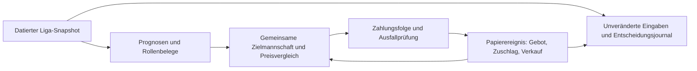

# Lokal prüfen, denselben Ablauf später auf dem Server betreiben

Stand 14.09.2026. Dieser neue Ablauf ist **lokal**, nicht in den Worker integriert
und nicht für Live-Transfers freigegeben. Die bestehenden Serverjobs laufen
unverändert. `kba-local` hat keinen Netzwerk- oder Kickbase-Schreibanschluss.

## Der konkrete Fehler und die Änderung

Die vorhandene Mannschaftsengine optimiert Zukäufe aus vorhandenem Geld. Bei
acht Spielern können ihre Verkaufs-/Tauschpfade keine gemeinsame Umschichtung
finanzieren. Der neue reine Planer `decision/rebuild.py` vergleicht zusätzlich
den gesamten Zielkader mit möglichen Abgängen. Sein Ziel ist zuerst eine
besetzbare Elf, dann bessere bedingte Punkte, dann weniger Transfers und Kosten.
Eine mathematisch finanzierte Zielmannschaft und eine durchführbare zeitliche
Zahlungsfolge sind unterschiedliche Ergebnisse. Ein blockierter Umbau bleibt
sichtbar; der Vergleich mit einem kleineren, heute bezahlbaren Fortschritt bleibt
erhalten. Auch Olise, Positionen, Vereins-/Kaderlimits und Verpflichtungen zählen.

## Lokaler Ablauf



Eine Verkaufsannahme ist kein Guthaben. Erst `sale_settled` verändert das
Papierkonto. `bid_submitted` reserviert Geld; erst `bid_won` macht den Spieler
zum Besitz. `bid_lost` löst die Reservierung auf und sperrt dieses gescheiterte
Ziel für den Replay. Danach wird mit dem neuen Zeitpunkt und Geld erneut
gerechnet. Doppelte Ereignisse sind wirkungslos, widersprüchliche werden
abgewiesen. Der gesamte Ablauf hat keinen Verweis auf einen Live-Executor.

Der Adapter übernimmt datierte echte Eingaben. Unbestätigte Managerabschlüsse,
fehlende Fitness-/Rollenbelege und aufgegebene Auktionen werden nicht als
verlässliche Zugänge behandelt. Alte Stornos ohne belegtes Auktionsende bleiben
konservativ gesperrt, bis ein unabhängiges neues Listing belegt ist.

## Ausführen

Im Verzeichnis `api/`:

```sh
uv run --python 3.12 kba-local --snapshot /absoluter/pfad/snapshot.json --output /absoluter/pfad/lauf
```

Für einen Fehler-/Erfolgspfad zusätzlich `--events /absoluter/pfad/paper-events.json`.
Die Datei ist eine Liste expliziter **simulierter** Ereignisse mit `event_id`,
`kind`, `player_id`, `amount_eur` und einem datierten `at` inklusive Zeitzone.
Bei Auktionen dürfen Gewinn/Verlust erst ab dem tatsächlichen Ende stattfinden.

`plan.md` ist der lesbare Vergleich; `plan.json` enthält Spielerbelege, Geld,
Preisvarianten und Papierjournal. Unter `runs/<hash>/` liegen unveränderte
Eingaben, Ereignisse, Quellcode-Hashes und Entscheidung. Das erlaubt spätere
Vergleiche mit tatsächlichen Ergebnissen, ohne heutiges Wissen rückzudatieren.

Ein echter Snapshot kann auf dem bestehenden Worker **nur lesend** mit
`scripts/export_rebuild_snapshot.py` erzeugt werden. Keine Zugangsdaten werden
exportiert. Die Abfragen sind nicht atomar; Konto, Kader und neue Bindungen
werden abschließend nochmals kontrolliert. Für den lokalen Lauf ist keine
Kickbase-Anmeldung erforderlich.

## Was das Modell derzeit leistet

Der lokale Replay verwendet dieselben gespeicherten Prognosen wie der datierte
Serverplan. Am 14.09. waren dies die Form-Baseline, keine aktivierten trainierten
Modelle. Historische Punkte-/Minutenkandidaten und ein Gebotsmodell existieren;
ihre zeitlichen Qualitätsprüfungen werden nicht gelockert. Ein LLM entscheidet
weder über tatsächliches Guthaben noch über bestätigten Spielerbesitz.

Die individuelle Preisprüfung benutzt `decision/bidding.py`: Jede Preisstufe
wird gegen die dadurch noch erreichbare Mannschaft und Alternativen verglichen.
Bei einem Umbau bleiben dafür dessen bedingte Abgänge fest. Ohne qualifiziertes
Gebotsmodell gibt es keine erfundene Zuschlagschance und keinen automatisch
begründeten Aufpreis. Einzelhöchstpreise dürfen nicht gemeinsam ausgeschöpft
werden, ohne das ganze Paket erneut zu finanzieren. Die bestehenden technischen
Grenzen bleiben zusätzliche Grenzen, kein Beleg für einen fairen Preis.

## Nächster Anschluss vor Serverbetrieb

Die Serverhardware ist nicht der Strategiefehler. Sie ist für einen späteren
zuverlässigen Dauerbetrieb sinnvoll; lokal sind identische Eingaben und
kontrollierte Fehlerszenarien leichter prüfbar. Es soll **eine Engine und eine
Schreibstelle** geben. Hermes liefert recherchierte, datierte Belege und kann
Aufträge auslösen; die Ausführung gehört ausschließlich dem `ActionExecutor`.

Vor Aktivierung muss die neue Zahlungsfolge mit Intents, frischer Rollen-/Preis-
prüfung, Bestandsabgleich und dem bestehenden Executor verbunden und getestet
werden. Insbesondere ist der autonome Starter-Schutz heute strenger als manche
rechnerischen Umbauten. Ein brauchbarer Umbau braucht zudem konkrete
Verkaufskonditionen und einen tragfähigen Ersatzweg nach verlorenen Auktionen.
Keine dieser Lücken wird mit einem bloßen `swap=True` oder gelockerten
Kontogrenzen umgangen. Dieser lokale Stand ist kein autonomer Saisongewinnbeweis.

Später sollte der Server bei Markt-/Kader-/Gebotsänderungen und spätestens im
bestehenden Zehn-Minuten-Takt prüfen. Nach jedem bestätigten Ausgang folgt
Neuplanung. Lernen bedeutet zunächst: damalige Eingaben vollständig festhalten,
spätere Punkte, Minuten, Zuschläge und Preise verbinden, Kandidaten gegen die
Baseline testen und nur belegte Verbesserungen aktivieren. Cron-Erfolg oder
Anzahl ausgeführter Käufe ersetzt keine Wirkungsmessung.
