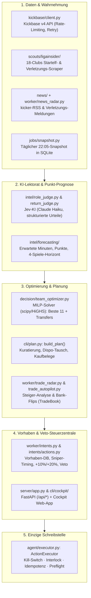

# Kickbase-Agent — Das System-Handbuch (Von Grund auf erklärt)

**Stand: 28.10.2026** · Branch `main` · **3.374 automatisierte Tests grün** · Produktion: `https://localhost:8080` (`203.0.113.10`)

Dieses Dokument erklärt das gesamte Programm **von Grund auf**:
1. **Was die Grundidee ist** und welche Spielmechanik wir lösen.
2. **Wie die Wochen-Strategie (Freitag bis Freitag)** funktioniert, damit am Anpfiff immer **11/11 Stammspieler auf dem Platz** stehen und **0 € totes Kapital** (Konto $\ge 0\text{ €}$) ungenutzt herumliegt.
3. **Wie das System technisch Schicht für Schicht aufgebaut ist** — von der Datenerfassung über den mathematischen MILP-Optimierer und den Flip-Autopiloten bis zur einzigen gesicherten Schreibstelle (`ActionExecutor`).
4. **Wo welche Datei liegt** und wie die Dokumentation strukturiert ist.

---

## 1. Die Grundidee: Was wir versuchen zu machen

Kickbase ist ein dynamisches Ressourcen- und Portfolio-Optimierungsspiel unter harten Nebenbedingungen. Jede Woche entscheidet sich der Erfolg an einer einzigen harten Ziellinie: **Freitagabend um 20:30 Uhr (Anpfiff des 1. Spieltags-Spiels).**

### 1.1 Die vier eisernen Spielregeln von Kickbase
1. **Konto-Regel am Anpfiff (`Konto >= 0 €`):** Wer beim Anpfiff des ersten Freitagsspiels auch nur `1 €` im Minus ist, bekommt für den **gesamten Spieltag `0 Punkte`** für alle 11 Spieler.
2. **11-Spieler-Regel (`11/11` besetzte Formationsplätze):** Jeder unbesetzte Platz in der Startelf bringt **`-100 Punkte` Strafe** (und verschenkt die `~80–120 Punkte` eines echten Stammspielers).
3. **Der 33-%-Dispo unter der Woche:** Zwischen Freitag 20:35 Uhr und dem nächsten Freitag 20:29 Uhr darf das Konto bis zu **`-33 %` des aktuellen Teamwerts** ins Minus gehen (bei `160 M €` Teamwert also rund `-53 M €` Kreditrahmen).
4. **Das tägliche 22:00-Uhr-Marktwert-Update:** Jeden Abend um 22:00 Uhr berechnet Kickbase alle Marktwerte neu. Spieler, die ligaweit gefragt sind, steigen um `+100k` bis `+500k €/Tag`; Bankdrücker und Verletzte fallen.

### 1.2 Unsere strategische Antwort darauf
Ein menschlicher Manager scheitert oft an zwei Extremen:
- **Zu passiv:** Er lässt aus Angst vor dem Freitags-Minus Millionen auf dem Konto liegen oder verkauft erst den alten Spieler und steht dann am Freitag mit **10/11 Spielern (`-100 Punkte`)** da, weil er die Auktion für den Ersatzspieler verliert.
- **Zu gierig / unkoordiniert:** Er kauft unter der Woche auf Kredit ein, vergisst rechtzeitig gegenzufinanzieren und muss am Freitagabend in Panik einen Stammspieler ersatzlos an den Computer verkaufen.

**Der Kickbase-Agent löst dieses Problem durch drei verzahnte Prinzipien:**

1. **Freitags-Zielzustand = 100 % Kapital auf dem Platz (`11/11` Starter, `Konto >= 10.000 €`):**
   Am Freitag um 20:30 Uhr ist das ideale Konto **nahe `0 €`** (mit `10.000 €` Sicherheits-Puffer), während **100 % unseres Vermögens in 11 fitten, verifizierten Stammspielern** auf dem Platz stecken. Es gibt keine starren Regeln wie „immer drei 500k-Spieler halten“, sondern das System entscheidet situativ nach Kontostand, Marktangebot und Gegner-Kalender.
2. **Erst Ersatz sichern, dann verkaufen (Gekoppelter Dispo-Tausch):**
   Wenn wir uns unter der Woche verbessern oder ein Kontodefizit durch ein Downgrade heilen wollen, verkaufen wir **niemals** zuerst einen unserer 11 Stammspieler ins Blaue hinein. Stattdessen nutzen wir den 33-%-Dispo, bieten **zuerst** auf den neuen Spieler (`swap_bid`) und koppeln den Verkauf des alten Spielers (`swap_sell`) hart an die Bedingung: **„Verkaufe erst, wenn der Kader mindestens 12 Spieler hat UND genau der gezielte Ersatzspieler im Kader steht“** (`squad_condition_unmet` in [`worker/intents.py`](../api/src/kickbase_agent/worker/intents.py)). Verlieren wir die Auktion, bleibt unser alter Stammspieler im Kader und die `11/11` sind unangetastet.
3. **Situativer, profitabler Flip-Autopilot („Börse unter der Woche, Elf zuerst“):**
   Unter der Woche nutzt der **Handels-Autopilot** ([`worker/trade_radar.py`](../api/src/kickbase_agent/worker/trade_radar.py), [`worker/trade_autopilot.py`](../api/src/kickbase_agent/worker/trade_autopilot.py)) freien Dispo-Spielraum, um stark steigende Spieler (`>= +5 %` in 3 Tagen, letzter Tag steigend) zu kaufen, die täglichen 22:00-Uhr-Marktwertsprünge mitzunehmen und sie vor Freitag wieder mit Gewinn an Kickbase zu verkaufen — **aber nur unter zwei strikten Bedingungen**:
   - **Positiver Erwartungswert:** Das Höchstgebot beträgt höchstens die Hälfte des statistisch erwarteten Anstiegs bis zum Verkaufstermin (`PREMIUM_SHARE = 0.5`). Wenn man mit dem Kauf kein Geld verdient, wird nicht geboten.
   - **Garantierte Freitags-Deckung & Elf-Vorrang:** Jedes Flip-Gebot muss selbst bei einem sofortigen Notverkauf zu 90 % Marktwert das Freitagskonto `>= 10.000 €` lassen (`sale_cover`), und sobald die Engine für die Startelf kaufen will („Elf zuerst“), weichen geplante Handelsgebote sofort.

---

## 2. Der Wochen-Lebenszyklus (3-Phasen-Trajektorie)

Das System steuert den Account nicht über isolierte Einzelentscheidungen, sondern als **Wochen-Trajektorie von Freitag bis Freitag**:

```mermaid
flowchart LR
  subgraph P1["Phase 1: Fr 20:35 – Di 22:00<br/>Akkumulation & Hebel"]
    A1["Dispo-Rahmen (-33 % Teamwert) offen"]
    A2["Handels-Autopilot: profitable Steiger-Flips kaufen"]
    A3["Engine: Startelf-Upgrades per gekoppeltem Dispo-Tausch"]
  end
  subgraph P2["Phase 2: Mi 00:00 – Do 22:00<br/>Konsolidierung & Heilung"]
    B1["T-96h / T-50h: Pflicht-Liquidation aller Bank-Flips"]
    B2["Gekoppelte Tausch-Verkäufe nach Auktionszuschlag ausführen"]
    B3["Konto < 0 €? Situativer Downgrade-/Anker-Tausch (hält 11/11!)"]
  end
  subgraph P3["Phase 3: Fr T-120 bis Anpfiff<br/>Versiegelte Anpfiff-Kaskade"]
    C1["T-120 (18:30): Ungedeckte Gebote stornieren + Gebots-Freeze"]
    C2["T-60 (19:30): Debt-Ping + beste 11er-Aufstellung (19:45)"]
    C3["T-15 (20:15): Notbremse (S0 Gebote -> S1 Flips -> S1b Bank -> S2)"]
  end
  P1 --> P2 --> P3
```

### Phase 1: Akkumulation, Flips & Upgrades (Freitag nach Anpfiff bis Dienstag)
- **Was passiert:** Die Spiele laufen bzw. sind abgepfiffen; der Transfermarkt hat die längste Restlaufzeit bis zum nächsten Freitag.
- **Handels-Radar (`08:12` & `22:35`) + Handels-Autopilot (`:17` & `:47`):** Sucht fitte Kickbase-Auktionen (`0,5–18,5 M €`, KB-Stufe 1–3), die in den letzten 3 Tagen mindestens `+5 %` gestiegen sind und weiter steigen. Prüft per Jev-KI (`intel/role_judge.py`), ob eine Verletzung/Sperre vorliegt, und legt nur dann Gebots-Vorhaben an, wenn der erwartete Gewinn positiv und das Freitagskonto gedeckt ist.
- **Engine-Planer (alle 10 Minuten auf `:03, :13, :23, :33, :43, :53`):** Prüft den kompletten Kader und alle Kickbase-Auktionen. Findet der MILP-Optimierer einen stärkeren Starter oder einen überfälligen Tausch für einen angeschlagenen/fallenden Spieler, plant er ein gekoppeltes Tausch-Paar (`swap_bid` + bedingter `swap_sell`).

### Phase 2: Konsolidierung & aktive Defizit-Heilung (Mittwoch bis Donnerstag)
- **Verkaufstermin für Flips (`trade_book.sale_deadline`):**
  - Hat die Startelf noch eine Lücke (`< 11` Plätze), werden alle Handelsspieler schon bei **`T-96h` (Montagabend)** verkauft, damit das gesamte Kapital für den 11. Startelf-Spieler frei ist.
  - Ist die Startelf voll (`11/11`), werden alle Handelsspieler spätestens bei **`T-50h` (Mittwochabend 18:30 Uhr)** oder sofort nach dem ersten fallenden 22:00-Uhr-Update verkauft.
- **Aktive Konto-Heilung bei `Konto < 0 €` (`_plan_overdraft_swap` in [`cli/plan.py`](../api/src/kickbase_agent/cli/plan.py)):**
  - Steht das Konto im Minus (z. B. nach einem Vorab-Kauf), sucht der Planer einen **Konto-heilenden Tausch**: Ein teurer eigener Spieler wird gegen einen günstigeren verifizierten Stammspieler (oder situativen Anker) getauscht, dessen Erlös-Differenz (`0,9 × Verkaufspreis − Kaufpreis`) das Minus komplett ausgleicht.
  - Die Verkaufskaskade schützt dabei unsere Leistungsträger:
    1. **Stufe 0:** Bankspieler (`KB-Stufe 4/5`, LigaInsider `BENCH`/`OUT`) oder Punkt-Totalausfälle.
    2. **Stufe 1:** Unbestätigte Starter oder stark fallende Spieler (`<= -100k €/Tag`).
    3. **Stufe 2:** Normale Starter auf mehrfach besetzten Positionen.
    4. **Notfall-Stufe (`emergency_deficit_relief`):** Selbst wenn alle 11 Starter im Marktwert steigen, wird bei offenem Kontominus lieber ein redundanter Starter in einen günstigeren Starter getauscht, als am Freitag in die ersatzlose `T-15`-Notbremse (`10/11`, `-100 Punkte`) zu laufen.

### Phase 3: Versiegelte Anpfiff-Kaskade (Freitag vor Anpfiff)
Ab zwei Stunden vor dem ersten Anpfiff übernimmt [`worker/kickoff_guard.py`](../api/src/kickbase_agent/worker/kickoff_guard.py):
- **`T-120` (Freitag 18:30 Uhr):** `run_bid_cancel_guard` storniert offene Gebote, die das Konto unter `+10.000 €` drücken würden. Gleichzeitig greift der harte **Bid-Freeze** im Executor (keine neuen Gebote mehr bis Anpfiff).
- **`T-60` (Freitag 19:30 Uhr) & `19:45 Uhr`:** `run_debt_ping` prüft das Konto und warnt bei Rest-Minus; um `19:45 Uhr` setzt `lineup_job` die punktbeste 11er-Formation live bei Kickbase.
- **`T-15` (Freitag 20:15 Uhr):** `run_purge_enforce` ist die letzte eiserne Notbremse. Sollte das Konto trotz allem noch `< 10.000 €` stehen, verkauft sie deterministisch in der Reihenfolge:
  - **`S0`:** Offene Gebote stornieren
  - **`S1`:** Handelsspieler (`TradeBook` + `load_trading_holdings`) verkaufen
  - **`S1b`:** Nicht-Starter und LigaInsider-Bankspieler (`_gather_li_bench_ids`) verkaufen
  - **`S2`:** Redundante Starter mit dem schwächsten Momentum verkaufen (niemals geschützte Core-Spieler wie Olise `8329`, niemals den einzigen Torwart).
- **`T-8` (Freitag 20:22 Uhr):** `late_lineup_check` prüft ein letztes Mal die Live-Aufstellung und füllt eventuelle Lücken sofort nach.

---

## 3. Technischer Aufbau Schicht für Schicht

Das gesamte Backend liegt in `api/src/kickbase_agent/` und ist strikt in sieben Schichten getrennt:

### Schicht 1: Daten & Wahrnehmung (`kickbase/`, `scouts/`, `jobs/`)
- **[`kickbase/client.py`](../api/src/kickbase_agent/kickbase/client.py) & [`kickbase/models.py`](../api/src/kickbase_agent/kickbase/models.py):** Asynchroner HTTP-Client für die Kickbase-v4-API (mit Token-Refresh, `1 req/s` Drosselung und automatischem Retry bei 429/5xx). Liest Liga-Kader, Transfermarkt (`exs` Auktions-Restzeit, `u` Verkäufer), eigenes Budget (`b` aktueller Kontostand, `pbaa` Konto nach offenen Geboten), 365-Tage-Marktwertverlauf (`it/trp`) und Einsatzminuten (`performance`).
- **[`scouts/ligainsider/`](../api/src/kickbase_agent/scouts/ligainsider/):** Scrapt alle 18 Bundesliga-Vereinsseiten auf LigaInsider. Ordnet jedem Spieler einen klaren Status zu (`STARTER`, `COMPETITION`, `BENCH`, `OUT`) und erkennt **Profiteure** (`profiteur.py`), die durch die Verletzung eines Stammspielers in die Startelf rücken.
- **[`jobs/snapshot.py`](../api/src/kickbase_agent/jobs/snapshot.py):** Läuft täglich um `22:05 Uhr` (direkt nach dem Kickbase-Marktwert-Update um `22:00 Uhr`) sowie dienstags um `04:10 Uhr` (`history_reload.py`) und sichert alle Marktwerte und Spieltags-Einsätze revisionssicher in der SQLite-Datenbank (`kba.db`).

### Schicht 2: KI-Lektorat („Jev“) & Punkt-/Minuten-Prognose (`intel/`)
- **[`intel/role_judge.py`](../api/src/kickbase_agent/intel/role_judge.py) & [`intel/return_judge.py`](../api/src/kickbase_agent/intel/return_judge.py):** Unsere spezialisierte KI-Prüfschicht („Jev“). Sie entscheidet **niemals** frei über Käufe, sondern beantwortet anhand aktueller kicker-Artikel streng strukturierte Fragen mit Konfidenz-Score:
  - *Rollenfrage (`judge_roles`):* Fehlt ein Spieler sicher (`fehlt >= 0.95`), droht die Bank (`bank >= 0.80`) oder kehrt er nach Verletzung/Sperre in die Startelf zurück (`rueckkehr >= 0.85`)?
  - *Renditefrage (`judge_returns`):* Rechtfertigen Aufstiegs- oder Comeback-Signale einen moderaten Gebotsaufschlag?
- **[`intel/forecasting/`](../api/src/kickbase_agent/intel/forecasting/) & [`cli/plan.py`](../api/src/kickbase_agent/cli/plan.py):** Berechnet für jeden Kader- und Marktspieler:
  - `expected_minutes` und `expected_points` für den nächsten Spieltag.
  - `horizon_points` über die nächsten **4 Spieltage**, gewichtet mit der Schwierigkeit des Spielplans aus Buchmacher-Quoten (`fixture_horizon_multiplier` in [`intel/signals.py`](../api/src/kickbase_agent/intel/signals.py)).

### Schicht 3: Das Entscheidungs-Gehirn (`decision/` & `cli/plan.py`)
- **[`decision/team_optimizer.py`](../api/src/kickbase_agent/decision/team_optimizer.py):** Formuliert die Kaderplanung als **Mixed-Integer Linear Program (MILP)** und löst es exakt mit `scipy.optimize.milp` (HiGHS-Solver). Der Optimierer wählt gleichzeitig:
  - Welche Spieler gekauft/gehalten werden,
  - Welche 11 Spieler in welcher der 9 erlaubten Formationen (`3-4-3`, `3-5-2`, `4-3-3`, `4-4-2`, `4-5-1`, `5-2-3`, `5-3-2`, `5-4-1`, `3-6-1`) auf dem Platz stehen,
  - Unter Einhaltung aller Nebenbedingungen (Positions-Minima/Maxima, Vereinslimit, verfügbares Budget inkl. Dispo-Brücke).
- **[`cli/plan.py`](../api/src/kickbase_agent/cli/plan.py) (`build_plan`):** Orchestriert den gesamten Planungszyklus:
  1. Prüft bestehende Gebots-Verpflichtungen und heilt eventuelle Überbuchungen (`decision/funding_recovery.py`).
  2. Prüft für jeden Marktspieler die harten Kaufkriterien (`reject_reason`, `role_proof_gap`: ab 5 M € mind. 2×60 Minuten oder bestätigter Breakout/Comeback/Profiteur; unter 5 M € keine reinen Kurzeinsatz-Joker für Upgrades).
  3. Löst den MILP-Optimierer für direkte Käufe (`buys`) und für gekoppelte Dispo-Tauschpaare (`_plan_overdraft_swap` -> `swaps`).
  4. Erzeugt für jedes gewählte Gebot einen versiegelten **Kaufbeleg (`purchase_review`)**, der den kompletten Mannschaftsplan (`team_plan`), die geprüften Gebotsszenarien (`bid_scenarios`) und ggf. den gekoppelten Tauschverkauf (`swap_sale`) enthält.

### Schicht 4: Der Handels-Autopilot (`worker/trade_radar.py`, `worker/trade_autopilot.py`, `trading/trade_book.py`)
- **[`trading/trade_book.py`](../api/src/kickbase_agent/trading/trade_book.py):** Führt das **Handelsbuch (`TradeBook`)** direkt aus den realen Audit- und Intent-Zeilen der Datenbank. Ein Kaderspieler gilt genau dann als Handelsspieler (`TradePosition`), wenn sein jüngstes erfolgreiches Gebot vom Handels-Autopiloten stammt.
- **[`worker/trade_radar.py`](../api/src/kickbase_agent/worker/trade_radar.py):** Analysiert zweimal täglich (`08:12` und `22:35`) alle Kickbase-Auktionen auf 3-Tage-Marktwertwellen (`>= +5 %`), berechnet aus den eigenen historischen Marktwert-Daten der letzten 14 Tage den erwarteten Anstieg je Steigungsstufe (`5–10 %`, `10–15 %`, `>= 15 %`) über die verbleibenden 22:00-Updates bis zum Verkaufstermin (`sale_deadline`) und setzt `max_bid` auf maximal 50 % dieses erwarteten Anstiegs (gedeckelt bei `130 %` MW).
- **[`worker/trade_autopilot.py`](../api/src/kickbase_agent/worker/trade_autopilot.py):** Setzt die Radar-Signale alle 30 Minuten (`:17` und `:47`) in Vorhaben um — streng untergeordnet unter die Startelf („Elf zuerst“: niemals bieten, solange die Engine plant oder ein Gebot offen hat) und streng gedeckt zum Freitag (`coverage >= 10.000 €` selbst bei 90-%-Verkauf).

### Schicht 5: Vorhaben-Steuerung & Veto-Zentrale (`worker/intents.py`, `intents/actions.py`, `server/`, `cli/cockpit/`)
- **Warum Vorhaben (`Intent`) statt direkter API-Writes?**
  Weder die Engine noch der Handels-Autopilot schreiben jemals direkt an Kickbase. Sie legen Zeilen in der Tabelle `intents` an (`status = 'planned'`).
- **Timing & Sniper-Logik (`schedule_for` in [`worker/intents.py`](../api/src/kickbase_agent/worker/intents.py)):**
  - **Kickbase-Auktionen (`listing_type == 'kickbase'`):** Werden auf **`Deadline - 15 Minuten`** (`EXECUTE_BEFORE_DEADLINE`) terminiert, damit wir anderen Managern nicht stundenlang vorher unser Gebot zeigen (Sniper-Prinzip), aber ab `>= 5 M €` immer mindestens 2 Stunden Veto-Fenster für Emil lassen.
  - **PBAA-Retry (`PBAA_RETRY_CUTOFF = 3 Minuten`):** Falls Kickbase bei `Deadline - 15 min` kurzzeitig das Feld `pbaa` nicht liefert oder ein Netzwerkfehler auftritt, versucht der Executor das Gebot 10 Minuten später (`Deadline - 5 min`) automatisch noch einmal.
  - **Gekoppelte Tausch-Verkäufe (`squad_condition_unmet`):** Haben `execute_at = now`, warten aber in 15-Minuten-Schritten geduldig, bis das gekoppelte Auktionsgebot gewonnen ist (`target_owned == True` und `len(squad) >= 12`). Sobald der Ersatz im Kader steht, wird der Zuschlag vermerkt (`swap_won_at`), der Verkaufspreis auf den frischen Marktwert aktualisiert (`_refresh_dispo_sale_amount`) und der alte Spieler an Kickbase verkauft.
- **Eingriffsmöglichkeiten für Emil (`intents/actions.py`):**
  Über das Web-Cockpit (`https://localhost:8080`) oder Discord-Buttons kann Emil jedes geplante Vorhaben jederzeit:
  - **Überspringen (`veto_intent`)**: Sperrt diesen Spieler für den Rest des Tages (bzw. bis zum Auktionsende).
  - **Anpassen (`adjust_intent`)**: `+10 %`, `+20 %` (rastert bei Engine-Geboten automatisch auf das nächste geprüfte Szenario in `bid_scenarios`) oder freier Euro-Betrag bis `150 %` (solange die Kaufprüfung gedeckt bleibt).
  - **Sofort ausführen (`execute_intent_now`)**: Zieht `execute_at` auf sofort vor.

### Schicht 6: Die einzige Schreibstelle (`agent/executor.py` & `decision/purchase_review.py`)
Jede echte Schreibaktion an Kickbase (`bid`, `cancel_bid`, `sell`, `list`, `delist`, `accept`, `decline`, `lineup`, `bonus`) **muss** durch [`ActionExecutor.execute()`](../api/src/kickbase_agent/agent/executor.py) laufen. Dort greifen 5 unabhängige Schutzschichten:
1. **Schicht 0 — Verfassung:** Geschützte Spieler (`protected_player_ids`, insbesondere Michael Olise `8329`) können durch keinen Codepfad der Welt verkauft, gelistet oder abgegeben werden — auch nicht durch die Freitags-Notbremse.
2. **Schicht 1 — Idempotenz:** Jede Aktion erhält einen eindeutigen `idempotency_key` in `transfer_actions`. Doppel-Klicks oder parallele Läufe werden auf Datenbank-Ebene abgefangen (`duplicate`).
3. **Schicht 2 — Kill-Switch (`AGENT_DRY_RUN`):** Ist `AGENT_DRY_RUN=1`, wird die Aktion nur als `skipped_dry_run` protokolliert und berührt niemals das Netzwerk.
4. **Schicht 3 — Pfad-Interlock:** Jeder Aktionstyp hat seinen eigenen Schalter (`AGENT_AUTO_INTENTS` für Vorhaben, `AGENT_AUTO_LINEUP` für Aufstellung, `AGENT_AUTO_BONUS` für Prämie, `AGENT_AUTO_PURGE` für die Freitags-Notbremse).
5. **Schicht 4 & 5 — Audit-First & Live-Preflight (`default_preflight`):**
   - Bevor ein einziger Request an Kickbase rausgeht, wird die Zeile als `pending` in SQLite committet.
   - Unmittelbar vor dem Write liest der Preflight **frisch** von Kickbase: Kontostand (`b` & `pbaa`), Kader, Markt und Spieler-Details.
   - Er prüft [`purchase_review_veto`](../api/src/kickbase_agent/decision/purchase_review.py) und [`team_funding_veto`](../api/src/kickbase_agent/decision/purchase_review.py): Ist der Beleg noch gültig ($\le 3\text{ h}$)? Ist der Spieler noch fit (`fitness_status == 0`)? Reicht das frische Konto inkl. gekoppelter Tausch-Verkäufe und 33-%-Dispo-Grenze? Ist der Aufschlag innerhalb der Kappe? Liegt kein T-120-Gebots-Freeze vor? Verletzt ein Verkauf nicht das Positions-Minimum (`1 TW, 3 ABW, 2 MF, 1 ST`) oder die 11er-Startelf?
   - Erst wenn **alle** Prüfungen grün sind, geht der HTTP-Call an Kickbase raus und die Zeile springt auf `executed`.

---

## 4. Wegweiser durch die Dokumentation (`docs/`)

Damit man sich sofort zurechtfindet, ist die Dokumentation in vier klare Kategorien gegliedert:

### A. Einstieg & Gesamtverständnis (Zuerst lesen)
| Dokument | Zweck |
|---|---|
| **[`README.md`](../README.md)** | Schnelleinstieg auf Repo-Ebene: Kurzüberblick, Architektur-Diagramm, lokale Befehle. |
| **[`docs/SYSTEM-HANDBUCH.md`](SYSTEM-HANDBUCH.md)** | **(Dieses Dokument)** Gesamterklärung des Programms von Grund auf: Spielmechanik, Wochen-Trajektorie, alle 7 Architektur-Schichten. |
| **[`CLAUDE.md`](../CLAUDE.md)** / **[`AGENTS.md`](../AGENTS.md)** | Verbindliche Betriebsanleitung und eiserne Regeln für alle KI-Agenten (Claude Code, Hermes, Antigravity, Codex). |
| **[`docs/PROJEKT-ZIEL.md`](PROJEKT-ZIEL.md)** | Die 5 messbaren Abschlusskriterien (`D1`–`D5`: Elf, Geld, Betrieb, Punkte, Ruhe) über vier Spieltage in Folge. |

### B. Technik, Schnittstellen & Begriffe (Nachschlagewerke)
| Dokument | Zweck |
|---|---|
| **[`docs/ARCHITEKTUR.md`](ARCHITEKTUR.md)** | Detail-Referenz aller Python-Pakete, Datenbank-Tabellen (`transfer_actions`, `intents`, `reports`, `players` ...) und Modul-Abhängigkeiten. |
| **[`docs/API.md`](API.md)** | Referenz aller 23 MCP-Tools (`kickbase`), der FastAPI-Endpunkte (`/api/*`) und der CLI-Befehle (`uv run kba ...`). |
| **[`docs/GLOSSAR.md`](GLOSSAR.md)** | Übersetzungstabelle aller Kickbase-API-Kürzel (`pbaa`, `tfhmvt`, `exs`, `lo`, `prob`, `st`) und internen Fachbegriffe. |

### C. Betrieb & Produktion (Runbook)
| Dokument | Zweck |
|---|---|
| **[`docs/BETRIEB.md`](BETRIEB.md)** | Das Produktions-Runbook für `root@203.0.113.10`: Docker-Container, der exakte `rsync`-Deploy-Einzeiler, Sperrfenster (`21:25–22:25`), Störungsbehebung. |
| **[`.claude/skills/kickbase/LEARNINGS.md`](../.claude/skills/kickbase/LEARNINGS.md)** | Chronologisches Gedächtnis aller realen Betriebslektionen (`L-001` bis `L-125+`), damit kein Fehler zweimal passiert. |
| **[`api/src/kickbase_agent/knowledge/parameter_history.json`](../api/src/kickbase_agent/knowledge/parameter_history.json)** | Lückenloses Decision-Log jeder Parameter- und Regeländerung mit `reason`, `expect`, `review` und `commit`. |

### D. Strategie, Studien & Historie
| Dokument | Zweck |
|---|---|
| **[`docs/STRATEGIE-SAISON-26-27.md`](STRATEGIE-SAISON-26-27.md)** | Strategischer Rahmen für die Saison 2026/27 (Marktwert-Kurven, Kader-Aufbau, Transfer-Haushalt). |
| **[`docs/RECHERCHE-META-STRATEGIEN.md`](RECHERCHE-META-STRATEGIEN.md)** | Externe Faktenbasis zu Kickbase-Punkten, Prämien und Marktwert-Mechanik. |
| **[`docs/PROZESS.md`](PROZESS.md)** | Leicht verständliche Darstellung des Entscheidungsflusses anhand konkreter Beispiele. |
| **[`docs/STUDIE-TURNAROUND-2026-09-19.md`](STUDIE-TURNAROUND-2026-09-19.md)** | Historische Turnaround-Studie vom September 2026 (Ursprung des MILP-Optimierers und der Kaufbelege). |
| **`docs/superpowers/specs/` & `docs/archive/`** | Detail-Spezifikationen einzelner Subsysteme (Handels-Radar, Handels-Autopilot, Steuerzentrale, Cockpit) sowie archivierte Alt-Dokumente. |
